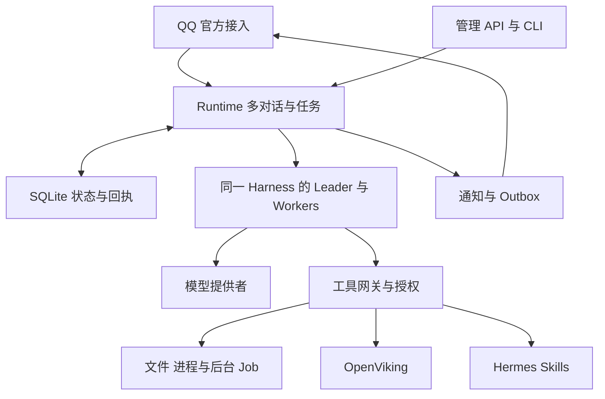
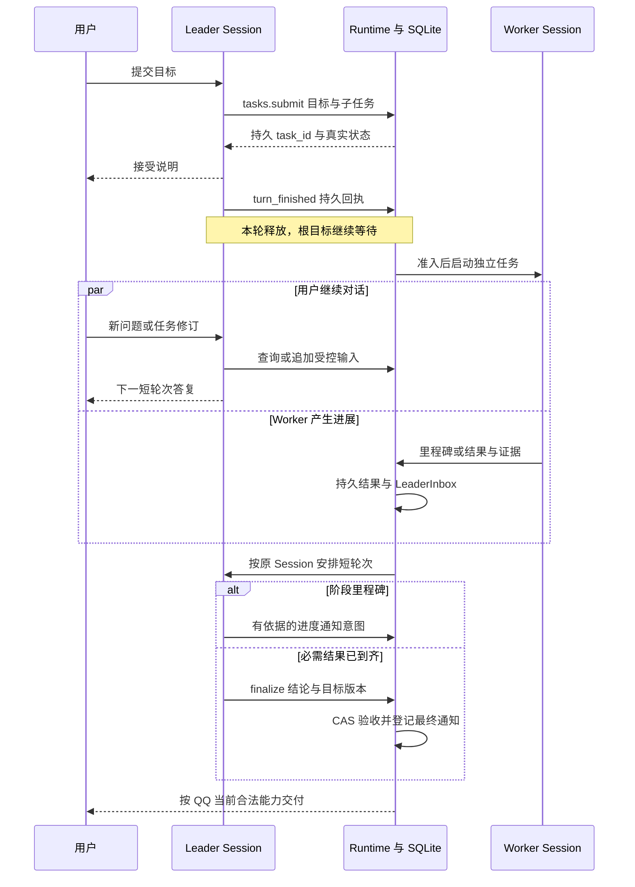
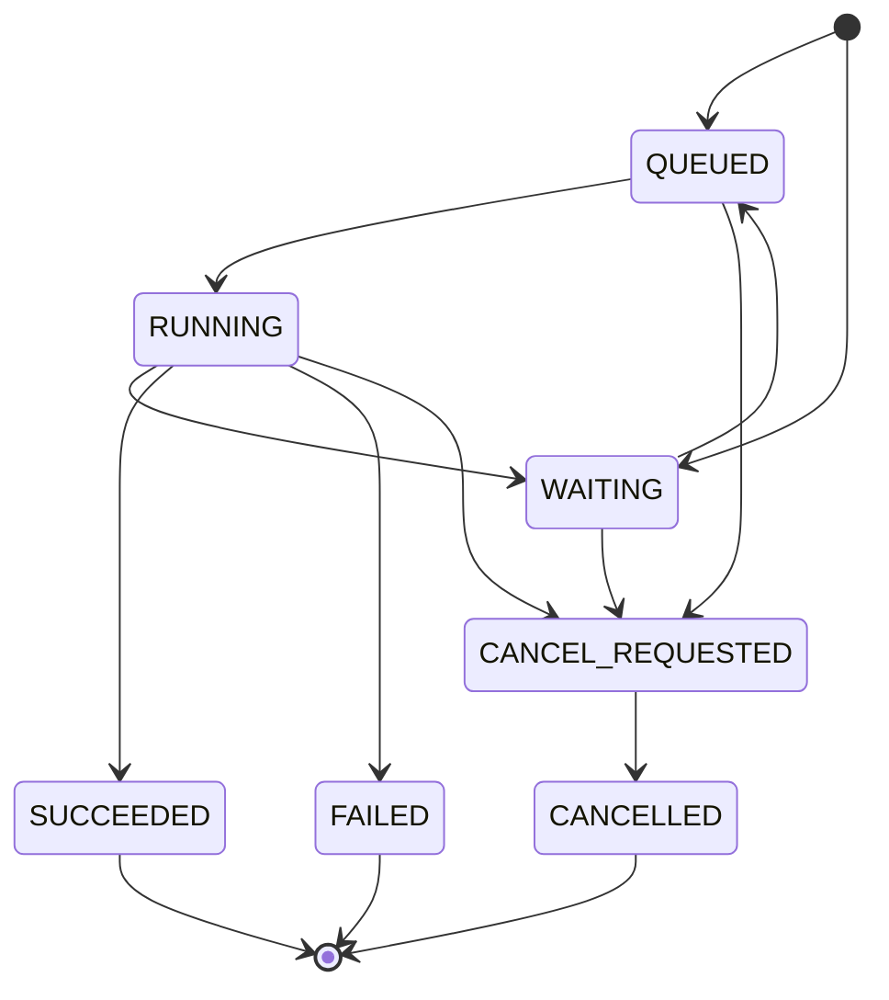
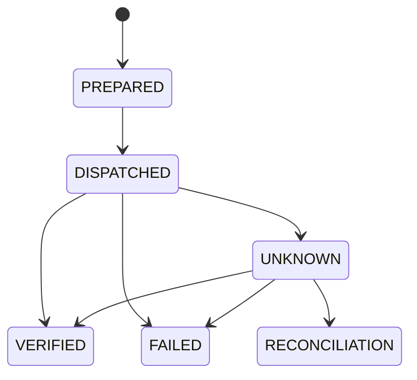

# Elephant Agent 实施方案：Leader 与按需 Workers

版本：2.0 · Leader 架构版  
日期：2026-11-12，Asia/Shanghai  
项目：[HalfAnElephant/Elephant-Bot](https://github.com/HalfAnElephant/Elephant-Bot)  
代码基线：`c6f1962d9f57bafbb6fc12b20cc571f00f90196b`  
用途：供项目维护者和开发 Agent 分阶段实施、代码评审与验收。

本项目转型为常驻服务器的个人 Agent，通过 QQ 官方能力接收指令、执行工作、持续汇报并交付结果。默认由一个个人 Leader 与用户对话，理解目标、按需派出 Workers、跟踪进展、核验成果并统一汇报。Leader 派发后结束当前轮次；任务继续由持久运行时管理，重要事件到达后再恢复 Leader 的短轮次。重构采用精简的单机架构，以可恢复任务、真实进度、可靠记忆和可替换组件为核心。本文中的接口、配置、命令和性能门槛是目标规范；现有代码行为在“现状”部分单独列出，不能将目标规范当作已经实现的能力。

**当前产品决策（2026-11-13）：** 本版原定的 Agent/任务数量、任务树深度与节点上限，以及固定的 60 秒／10 分钟两次进度节流均已被当前产品决定取代，不作为实施或验收要求。Agent 与任务接纳不设置固定数量上限；后台工作不执行 `total_wall_seconds` deadline。各 Task 与独立 Leader 输入轮次的调用预算持久累计，同 Task continuation/attempt 及同 Leader 输入 retry 共享预算；根目标只累计全树 `model_calls` 和 `tool_calls`，活跃时间按 Task 记录。现有模型请求容量、各工具与等待操作自身的超时语义继续生效。进度依当前有证据的事实合并、去重和失效，不添加固定播报频率。

本文整合本轮全部约束，替代 1.0 版中没有默认 Leader 的分派方式。一个 Leader 身份可以服务多个独立逻辑对话；每个对话拥有自己的 Session，Worker 按需创建。Agent 与进程不预留角色名额；模型请求池在总并发大于 1 时为 Leader 保留一个请求槽。实施不保留 NapCat 运行链路，不长期并行维护新旧执行器、两份可写记忆或两套 skills。QQ 官方已有能力及其可靠投递语义应完整保留。

**实施主线：** 先建立 Leader → Worker → 持久结果 → Leader 汇报的完整路径，再替换上下文、记忆与技能模块。Leader 负责判断和沟通，宿主负责状态、调度、权限、恢复及交付。它们共用现有 Harness，不另写第二套 Agent Loop。

## 阅读导航

- [0 用户重点问题与交付标准](#0-用户重点问题与交付标准)
- [1 产品范围与固定决策](#1-产品范围与固定决策)
- [2 现状审查与重构优先级](#2-现状审查与重构优先级)
- [3 目标架构与依赖规则](#3-目标架构与依赖规则)
- [4 后台任务、自然语言进度与会话非阻塞](#4-后台任务自然语言进度与会话非阻塞)
- [5 上下文、长期记忆与 Hermes Skills](#5-上下文长期记忆与-hermes-skills)
- [6 QQ 官方接入与 NapCat 下线](#6-qq-官方接入与-napcat-下线)
- [7 数据模型与状态契约](#7-数据模型与状态契约)
- [8 执行安全与故障恢复](#8-执行安全与故障恢复)
- [9 目录结构与运行配置](#9-目录结构与运行配置)
- [10 分阶段实施与迁移计划](#10-分阶段实施与迁移计划)
- [11 验收矩阵](#11-验收矩阵)
- [12 交给开发 Agent 的执行要求](#12-交给开发-agent-的执行要求)
- [13 证据与版本及实施前核对](#13-证据与版本及实施前核对)

## 0 用户重点问题与交付标准

| 用户关心的问题 | 目标行为 | 必须具备的实现 | 验收入口 |
| --- | --- | --- | --- |
| 是否智能分派后台 Agent | Leader 判断直接答复或委派；多步执行默认派给按需 Worker，用户可指定独立 Agent 或只讨论 | Leader 角色、结构化 TaskSpec、独立 Worker Session、派发后结束轮次 | T01、T02、T03、T25 |
| 是否自然语言汇报进度 | Worker 提交有证据的阶段事实，Leader 自动汇总关键进展、阻塞和完成；主动追问可查询 | TaskEvent、LeaderInbox、事件合并与短轮次恢复、QQ Outbox | T04、T05、T20、T26 |
| 是否阻塞当前会话 | Worker 执行时原 Leader 可继续接收新消息，也可按需新建其他对话 | Leader 轮次与根目标分离、逐 Session 单写者、统一资源准入、宿主控制通路 | T03、T06、T07、T25 |
| 是否自动沉淀 skills | 按 Hermes 的学习提示和条件复盘，直接创建或更新可复用技能；默认不需逐次确认 | 原生 skills_list、skill_view、skill_manage、标准 SKILL.md、官方后台 review 与写入语义 | T13、T14、T15 |
| 记忆是否正常运作 | 自动积累稳定事实和偏好，跨会话召回，可修正、忘记，故障后恢复 | OpenViking 增量同步、水位、来源、删除屏障、隔离和降级 | T09、T10、T11、T12 |
| 各层是否方便替换 | 更换模型、Harness、记忆或执行环境不改任务领域规则；兼容边界明确 | 接口定义、适配器、配置装配、能力握手、契约测试 | T16、T17、T18 |

“自动”表示系统负责触发、执行和记录闭环；不意味着模型判断永远正确。“不阻塞”表示 Worker 不占用 Leader 的 Session 写者资格，Leader 的一次短轮次也不会锁住其他对话和宿主控制通路。同一个 Leader Session 内的轮次仍然有序执行；Agent 与任务接纳不受固定数量上限约束，模型请求由 `ModelCapacity` 控制，总并发大于 1 时为 Leader 保留一个槽。单个模型推理、供应商配额及 QQ 网络时延单独监测。

## 1 产品范围与固定决策

### 1.1 必须实现

1. **个人身份优先。** 配置一个 owner，使用明确绑定的 QQ 官方 AppID 与用户 OpenID 识别；保留项目级资料边界，群成员不会自动获得 owner 的个人记忆或执行权限。
2. **QQ 官方唯一接入。** 保留私聊、群、频道及频道私信的已有能力。删除 NapCat、OneBot 适配器、配置、路由和部署路径。
3. **默认 Leader，按需 Workers。** Leader 是稳定的个人助手身份，负责理解、委派、核验和汇报；多个逻辑对话分别使用该角色及独立 Session。用户目标与 Leader 轮次分开保存，Worker 使用独立 Task Session。所有角色共用同一 Harness 与模型请求池，不预留 Agent 或进程名额；模型请求池在总并发大于 1 时为 Leader 保留一个槽。
4. **可恢复的工作。** 任务、等待、用户补充、取消、结果和投递独立持久化；重启后继续能够判断工作处于什么状态。
5. **一个压缩负责人。** 首期使用 Pi 原生压缩；OpenViking 的 takeover 关闭。billion-context 只有在专属适配器和验收通过后才替换压缩方式。
6. **一个长期记忆后端。** OpenViking 负责长期事实与知识检索；宿主只管理同步、权限、删除、预算和状态，不另建可写备用事实库。
7. **复用 Hermes 技能机制。** 采用其标准 `SKILL.md`、原生工具、学习提示及条件复盘；只适配目录、身份、工具注册与预算。Pi 自动 skills 扫描继续关闭；OpenViking 的技能检索副本可重建且不可独立修改。
8. **统一提示词组装。** 系统规则、实时用户指令、运行事实和检索资料有明确来源与顺序。授权在代码中执行，不由自然语言记忆或技能改变。
9. **真实的进度和结果。** 报告来自已提交的任务事件及操作证据；执行成功、学习成功、记忆写入成功、QQ 送达分别记录。
10. **最少部署单元。** 一个 Python daemon、SQLite、受管 Pi 子进程，再加一个 OpenViking 服务。部署优先 systemd，无需引入 Docker、Redis、Kafka、独立 Worker API 或通用工作流平台。

### 1.2 本次删除及暂缓的内容

删除群聊主动插话决策、社交预算、黑话和表达习惯学习、重复 persona 注入、research 专用执行器、基于 topic 的第二份历史 seed，以及仅为 NapCat 兼容存在的分支。用户明确配置的称呼、语言和沟通偏好保留为个人偏好。

初期暂缓插件市场、任意运行中热卸载、多租户组织体系、分布式任务租约、复杂任务 DAG、常驻多角色 Agent 团队、自动部署，以及第二个 QQ 官方接收协议。后续新增需求只增加对应适配器，不提前建设整套扩展平台。

### 1.3 首期技术组合

| 位置 | 首期选择 | 选择原因及替换边界 |
| --- | --- | --- |
| Host Runtime | Python，复用现有 FastAPI 与 SQLite 基础 | 现有任务、权限及 QQ 能力可逐步迁移；只保留一个状态拥有者 |
| 协作方式 | 默认 Leader + 按需 Workers | Leader 只运行短轮次；根目标、任务树、结果和待汇报事件持久保存，无额外协调服务 |
| Agent Harness | 项目锁定的 Pi 1.5.0 作为适配基线 | 保留现有模型与工具循环，先修桥接和会话持久化，不另写 Agent Loop |
| 模型 | 任务固定模型绑定，单次请求记录实际参数 | 更换 provider 不改变任务状态机；能力不足时明确拒绝对应任务 |
| 会话压缩 | Pi 原生 | 首期单一负责人；可评估 billion-context 专属集成 |
| 长期记忆 | OpenViking | 替换旧自研记忆路径；需锁定实际发行版并做真实服务验收 |
| Skills | Hermes 技能工具与标准文件目录 | 直接复用保存、更新和读取机制；沿用上游可用的审计与回退能力 |
| 外部执行 | 受控本地文件和进程；长进程使用宿主管理的 Job | 文件与命令使用同一执行环境和权限根，未来可整体换为 SSH 或其他隔离环境 |
| 用户界面 | QQ 官方；保留必要管理 API 和 CLI | 管理 API 直接调用 Runtime，不再伪造 QQ 消息创建任务 |

OpenViking 和 billion-context 不是必须一起安装的组合。OpenViking 当前也有接管 Pi 历史的能力，billion-context 则提供长会话的可恢复压缩；本文首期只启用前者的记忆与检索职责。billion-context 的“长会话”“token 节省”等上游效果主张不作为本项目已经达到的指标。[C1] [C2] [C3]

## 2 现状审查与重构优先级

### 2.1 已有基础与缺口

当前 main 已有持久任务、执行记录、权限、操作回执、Inbox/Outbox、QQ 官方富消息和本地文件发送，也已有 OpenViking 与 learned skills 接入。重构应复用经过验证的行为和测试，不以“精简”为由删除可靠性语义。[E1] [E2] [E3] [E4]

| 优先级 | 已核实问题或边界 | 实施处理 |
| --- | --- | --- |
| P0 | GitHub CLI 权限分类只检查部分位置参数，某些 flag 在前、URL 在后的命令会把真实目标错认成默认仓库 | 统一结构化解析，授权、执行、回读使用同一目标对象；未知语法拒绝执行 |
| P0 | 等待用户回答的任务存在按会话匹配、由另一主体提交输入后沿用原主体权限的路径 | 问题绑定 owner、task、question 与允许回复主体；输入和执行身份由宿主确认 |
| P0 | 后台循环异常退出时 readiness 可能仍返回成功 | 单个监督器记录循环状态，有限重启；关键循环不可恢复时 readiness 失败 |
| P0 | 后台 detach 只改变投递方式，现有全局执行上限下新交互仍可能饥饿 | Leader 派发后真实结束轮次；Worker 独立 Session；统一上限、公平调度和明确排队；状态与取消直接走宿主 |
| P1 | warm 进程按旧 seed 标记去重，新增加的宿主历史可能没有进入模型 | 持久 session 为唯一运行历史，新增输入按 ID 持久消费，删除第二份 seed |
| P1 | OpenViking 包装按消息变化重建快照，并非正式长期记忆后端 | 替换为增量同步、提炼结果跟踪、修正和忘记的闭环 |
| P1 | learned skills 已可保存，但作用域、归档配额、恢复及回滚不完整 | 迁移到 Hermes 文件目录和原生工具，停止旧数据库正文与候选保存链 |
| P1 | 长进程记录绑定当前 run，结束 run 会关闭进程 | 短命令保留隔离；真正的后台进程交给独立 Job 生命周期 |
| P1 | 管理任务创建依赖已知 QQ conversation 并构造消息事件 | TaskSpec 与渠道解耦，QQ 地址只属于入口及通知目标 |
| P1 | 删除适配器后旧 Outbox 条目被跳过，可能长期占据每批前 50 个位置 | NapCat 下线先终结或迁移待处理记录；缺失适配器转明确终态 |

前四项及 warm 上下文问题已在离线环境做过定点复现。这里是代码级修复依据，不表示发生了真实外部攻击。QQ 平台权限、客户端渲染、真实 OpenViking 提炼质量需要分别验收。[E1] [E2] [E3] [E5] [E6]

### 2.2 当前分支处理

主分支研究基线为 `c6f1962`。前次基线核查时，PR #4 是 open draft，head 为 `46f5f5b`，合并状态 dirty；实施时需重新核对分支状态。它包含部分执行、监督和上下文改进，但不能整包合并为最终架构。[E7]

现有 main 与 PR #4 分别存在同名 revision `0010` 的不同迁移。已经发布的迁移不可直接改号覆盖；应基于实际已部署数据库的 revision 建立新迁移，选择性移植行为与测试，再合并到新结构。迁移验收要同时覆盖 main 的数据库和实际存在的旧实验数据库，不能只测空库。

### 2.3 外部项目的取舍

| 参考 | 借鉴或复用的部分 | 本项目落点 |
| --- | --- | --- |
| Hermes | 技能发现、渐进读取、直接文件维护、学习提示和条件复盘 | 第 5.6 节按锁定源码移植，不自行设计技能保存过程 |
| OpenMausBot | Chief 分派后结束 turn、work/consult/notify、持久任务树与结果唤醒 | 第 4、7、8 章；Leader 使用同一 Harness，通信复用 Task 工具，不引入完整桌面产品或另一套 Assignment 账本 |
| DeepSeek Harness | 服务定义、实现和消费者的边界；持久会话与模型视图分离 | 第 3 章；Python 内部接口和适配器即可，不复制插件框架 |
| OpenViking | 长期记忆、资料组织、来源检索及异步提炼 | 第 5.1—5.5 节；不接管 Pi 当前对话、不另建技能学习 |
| billion-context | 长会话压缩与恢复的备选实现 | 后续独立评估；不作为首期必需依赖、不叠加压缩器 |

以上取舍分别依据对应项目的一手源码和说明。[H1] [H3] [H4] [O1] [O2] [O3] [D2] [C1] [C3] OpenMausBot 的普通 progress 不会自动唤醒父 Agent；本文的里程碑筛选、合并和 Leader 自然语言进度属于 Elephant 需新增的适配。[O4] consult 的业务只读权限也由宿主强制执行，不只依靠提示词。本次代码审查重点是执行、权限、上下文、记忆、技能与 QQ 交付，未把未执行的线上平台或全量安全测试写成已通过。

## 3 目标架构与依赖规则

### 3.1 部署和数据流



图中的 Runtime、工具网关、通知、上下文组装和技能管理都是同一个 Python 进程内的模块。箭头表示调用或事件流，不表示新增网络服务。Pi 进程与 OpenViking 保持必要的进程和 HTTP 边界。

### 3.2 依赖约束

核心只保留四个代码区域：`domain` 定义数据与状态；`contracts` 定义最小接口；`runtime` 实现应用规则；`adapters` 实现具体技术。只有组合入口读取配置并选择实现。

- `domain` 不导入 FastAPI、QQ SDK、Pi SDK、OpenViking SDK、SQLAlchemy。
- `runtime` 调用接口，不直接拼 QQ payload、不解析 Pi JSONL、不拼 OpenViking URL。
- Harness 内部可以使用自己的 provider SDK；业务层只能看到归一化能力、事件和回执。
- 工具网关拿到宿主注入的身份、任务、generation、工作目录与预算，模型无法在参数中替换它们。
- SQLite Repository 是存储实现，不能反向调用模型、QQ 或远端 API。
- 接口首先采用直接构造注入及配置工厂；不为可替换性添加服务发现、动态插件市场或微服务。

### 3.3 如何判断真的解耦

换实现只允许修改配置、适配器及其契约测试。若换模型需要修改 QQ 渲染，换记忆需要修改任务取消，或换 Harness 必须重写权限规则，视为分层未完成。

同一个接口不要求所有后端拥有相同能力。适配器必须声明能力；缺少必要能力时明确返回 unsupported。Task 固定不可变的运行组合引用，各 Attempt 继承，不能在重启后重新解析当前默认实现。更换配置默认只影响新任务；旧实现缺失时进入明确配置阻塞，不能静默把旧会话交给新 Harness。跨 Harness 的历史恢复需显式迁移，不能承诺任意互换后无损续跑。

### 3.4 参考 DeepSeek Harness 的接口分层

DeepSeek 官方 Harness 用 Cordis 组合插件，其 capability seam 由 Service Definition、Provider、Consumer 三种角色组成：先定义接口，再提供实现，由工具或运行时调用。它也把模型可见历史从持久 Session 日志推导。Elephant 采用这些职责划分，通过 Python Protocol 与构造注入落地。[D1] [D2]

| 层面 | Elephant 接口 | 首期实现 | 允许替换的内容 |
| --- | --- | --- | --- |
| 接入与通知 | `ChannelPort` | QQ 官方 Webhook 与 OpenAPI | 官方接收方式、消息 renderer；不改变任务语义 |
| 对话与任务应用层 | `SessionService`、`TaskService` | Leader 短轮次、按需 Workers、SQLite 与统一资源准入 | 角色策略、事件恢复、路由与调度；任务事实与权限仍由宿主掌握 |
| Harness | `HarnessPort` | Pi RPC adapter | 将来可添加 DSH、其他 Harness；保持输入、取消与事件契约 |
| 模型 | `ModelBinding` | Pi 支持的 provider 配置及适配 | 模型、endpoint、能力和用量归一化 |
| 提示词与上下文 | `ContextAssembler` | 一处组装与来源记录 | 检索策略、上下文预算；不复制运行历史 |
| 压缩 | `CompressionBinding` | Pi native | 适配过的 billion-context 等；同一会话只能选一个 |
| 记忆 | `MemoryPort` | OpenViking HTTP adapter | 检索和记忆后端；须提供迁移与删除能力 |
| 技能 | `HermesSkillsPort` | Hermes 原生工具与文件目录 | 隔离宿主依赖与目录；保存过程、文件格式和工具 schema 跟随锁定上游 |
| 工具与执行 | `ToolRegistry`、`ExecutionPort` | 受控工具、本地 FS/进程/Job | 浏览器、搜索、SSH 执行环境；统一授权与副作用记账 |
| 状态持久化 | `Repository` | SQLite | 将来替换数据库；不改变运行状态机 |

这是逻辑接口清单，不要求创建十个独立服务或十套框架。只为当前确实存在的依赖建立接口；纯函数与单一实现的内部帮助函数不做插件化。

DeepSeek 团队公开的 Superagent 原型可参考“外部工作事务内登记、提交后执行”“任务独立会话和目录”等设计。该仓库明确属于研究原型，并非正式 DeepSeek 产品；本项目不依赖其整个原型，也不把文章设想当作现成功能。[D5] [D6] [D7]

### 3.5 接口草案

以下是拟实现的宿主接口，使用的名字不是 Pi、DSH 或 OpenViking 的现成 SDK 名称。实际数据类型统一放在 `contracts`，不得由不同适配器各自定义近似结构。

```python
from collections.abc import AsyncIterator
from typing import Protocol

class HarnessPort(Protocol):
    async def describe(self) -> "HarnessCapabilities": ...
    async def open(self, spec: "SessionSpec") -> "SessionHandle": ...
    def run(self, request: "RunRequest") -> AsyncIterator["HarnessEvent"]: ...
    async def steer(self, request: "SteerRequest") -> "InputReceipt": ...
    async def cancel(self, attempt_id: str) -> "CancelReceipt": ...
    async def export_session(self, request: "SessionExportRequest") -> "SessionExport": ...

class MemoryPort(Protocol):
    async def search(self, request: "MemoryQuery") -> "MemorySearchResult": ...
    async def read(self, ref: "MemoryRef") -> "MemoryDocument": ...
    async def sync(self, batch: "SourceBatch") -> "SyncReceipt": ...
    async def poll(self, operation_id: str) -> "SyncReceipt": ...
    async def correct(self, request: "MemoryCorrection") -> "MutationReceipt": ...
    async def forget(self, request: "MemoryDeletion") -> "MutationReceipt": ...

class HermesSkillsPort(Protocol):
    async def skills_list(self, args: "SkillsListArgs", ctx: "ToolContext") -> "ToolResult": ...
    async def skill_view(self, args: "SkillViewArgs", ctx: "ToolContext") -> "ToolResult": ...
    async def skill_manage(self, args: "SkillManageArgs", ctx: "ToolContext") -> "ToolResult": ...

class ExecutionPort(Protocol):
    async def describe(self) -> "ExecutionCapabilities": ...
    async def read_file(self, request: "FileRead") -> "FileResult": ...
    async def write_file(self, request: "FileWrite") -> "OperationResult": ...
    async def run(self, request: "CommandRun") -> "CommandResult": ...
    async def start_job(self, request: "JobStart") -> "JobHandle": ...
    async def inspect_job(self, job_id: str) -> "JobStatus": ...
    async def cancel_job(self, job_id: str) -> "CancelReceipt": ...
```

技能接口只是 Hermes 工具的宿主适配壳：三个 `Args` 直接对应锁定上游 schema，`SkillManageArgs` 使用 `operations` 数组；`ToolContext` 是宿主注入的身份与可见范围，不暴露给模型填写。不得在壳内增加候选、审批、发布等必经阶段。具体机制见第 5.6 节。[H1] [H2]

`RunRequest` 统一承载 Leader 和 Worker，最少包含 attempt_id、session_id、role、purpose、不可变运行组合、宿主权限上下文及输入引用。Worker 的 task_id 指向本任务；Leader 普通 user/progress 轮次不拥有任何根任务的执行生命周期，只有引用范围；finalize 轮次固定一个 target_root_task_id 并取得该目标的短执行资格。Leader 角色配置不能绕过 TaskService 修改数据库状态。

Leader 输出按用途区分普通答复、进度、提问及最终结果。最终结果携带 goal_revision、实际消费的任务输入、成果及证据引用，由宿主完成 CAS 和唯一通知登记。不要从“模型给出了最终文本”推断所有关联目标已成功；也不要在任务工具外另建一个 Coordinator Loop。

`HarnessEvent` 必须提供可验证的 `run_yielded(reason, session_revision, consumed_through)`：等待条件已落库、等待工具的调用与结果已成对写入会话、本轮不再发模型或工具请求，并且在途活动已停止。Runtime 收到该回执后才释放 Runner；普通工具返回 `waiting=true` 或数据库改成 WAITING 均不算完成暂停。若 Pi 当前 RPC 不提供这个边界，须在桥接层补齐，不能用可能截断工具结果的 cancel 冒充安全让出。

正常 `turn_finished` 也须确认本轮消息与工具结果已持久化、输出已登记、无在途活动，才能释放 Session 写者。LeaderInbox 的 accepted、persisted、handled 分开：输入进入 Pi 日志只更新 persisted；本轮对应输出、工具意图及通知意图已落库，才将本轮确实处理的事件置 handled。按事件 ID 确认，不能推进一个 Session 总游标而吞掉其他根目标未处理的事件。Leader 重启恢复只处理未结算的轮次，不重跑已完成 Worker。

`SessionExportRequest` 指定 session、授权范围、分支与增量游标；`SessionExport` 返回规范化原始源事件、稳定 event_id、角色、内容或附件引用、来源、分支/版本和 next_cursor。原生文件格式由 adapter 解析，压缩摘要不能替代源事件，Runtime 不直接解析 Pi JSONL，也不另存一份可写完整模型历史。分支变化须明确标记，不能把已放弃分支当作新的用户事实。导出可用于记忆同步和审计，不等同于跨 Harness 精确续跑。

`ExecutionPort` 的文件、命令、cwd、环境变量和工作区必须来自同一个 execution world。更换为 SSH 后，不能仍然从本机读取一个“同名文件”，再在远端运行命令。后台 Job 的日志、退出码和进程身份由其 provider 管理，不由 Pi 会话是否存活决定。[D2]

### 3.6 能力握手及版本固定

启动时完成配置与接口版本验证，任务创建时固定组合快照。握手只是能力声明，关键语义还必须通过契约测试。

组合包含 Harness/契约版本、已解析的模型绑定、execution world、工作区、角色配置与压缩格式；Session 与 Task 保存相应引用，Attempt 继承。根目标的协调组合与原 Leader Session 兼容；Worker 可选择不同模型 profile，但必须在子任务创建时解析并固定。修改默认配置只影响新的绑定，已有 Session 不因重启自动换 Harness。权限、取消、QQ 关系及当前回复凭据实时检查；凭据固定引用，轮换后的值从安全存储解析。

| 组件 | 最少声明字段 | 不满足时的行为 |
| --- | --- | --- |
| Harness | `contract_version`、持久输入确认、消费水位、安全让出、取消、恢复级别、增量源事件导出、宿主工具桥接、流式事件、可用压缩模式 | 必需能力缺失时拒绝相关任务；不伪装支持 |
| Model | 工具调用、图像输入、上下文容量、最大输出、usage、错误分类 | 在执行前说明不支持，或按明确配置选兼容模型 |
| Memory | 搜索、来源范围、修改、删除、异步状态、幂等与导出能力 | 记忆降级但当前会话可用；不把“已受理”当“已完成” |
| Execution | cwd 与文件空间、取消、进程树清理、后台 Job 恢复级别 | 不支持持久 Job 时明确拒绝“重启后继续运行”承诺 |
| QQ | 各 surface 的入站、出站、媒体、流式及已验证权限 | 按真实范围渲染或明确说明限制 |

Model 层在 Pi 方案中可以是 Harness adapter 内部的独立实现与配置边界，宿主不再写一套模型—工具循环。单次请求先固定实际 provider、model、参数和凭据引用；重试由唯一所有者计数，默认沿用 Harness 的模型重试，不在宿主层重跑整个未知 run。[D4]

Agent 与任务接纳不设固定数量上限；实际模型请求由共享 `ModelCapacity` 控制。总并发大于 1 时，容量池为 Leader 请求保留一个槽，Worker/复盘等后台请求最多使用 `total - 1` 个槽；所有请求仍计入总并发。每次真实请求、重试和压缩均申请并释放一个槽。OpenViking 的服务端提炼调用使用其自身服务配置，不计入 Pi provider 容量。验收统计真实请求而非只数进程。

Compression 需要区分两类实现：一类通过 Harness 的原生压缩接口管理会话视图；另一类如 billion-context 可通过明确配置的插件或模型传输代理管理有效请求。后者必须保存稳定会话 ID、压缩账本及请求来源映射，并验证取消、工具配对、重启和故障恢复。不能假设它已有一个可供 Python 直接调用的通用 `compact()` 接口，也不能在不记录的情况下改写模型请求。[C3] [D8]

替换压缩实现默认只用于新会话；需要迁移时，先导出原始日志及压缩状态并完成回放验证。若压缩账本丢失，不应无条件把超长原始历史直发上游；应恢复备份、按支持的方式重建，或明确进入受控的新会话交接。

### 3.7 Leader 的一次委派如何结束并恢复



图中的接受说明也通过同一 Notification/Outbox 投递；Leader 不直接调用 QQ API。Runtime 的唤醒是持久事件进入统一队列，不保证立即有模型额度。Leader Session 忙时有序等待，Workers 不持有它的写者资格。最末一步发送失败只处理 Delivery，不重新派发已完成工作。

## 4 后台任务、自然语言进度与会话非阻塞

### 4.1 目标与实施边界

本章是拟实施设计，面向“一个 Python 常驻进程、一个 SQLite 数据库、按需启动 Pi 子进程、仅 QQ 官方接入”。守护进程内部保留接入、会话、任务、执行器、权限与投递模块；模块直接调用明确接口，不增加独立 Router、进度播报 Agent、Worker 服务或消息总线。Pi 负责推理和工具选择，宿主负责状态、预算、权限与可靠交付。

现有项目已有 `TaskGoal/ExecutionPlan`、任务租约、fencing、事件、等待、通知、Outbox 与副作用台账，应收敛复用。当前 `dialogue/planner.py` 主要依赖关键词确定初始后台模式，进程级 Worker 通过内部 HTTP 调用 Core；本方案将监督与调度移入守护进程，不把现有实现描述成已经完成该架构。[E8] [E12]

首先分开 **Leader 身份、Leader 轮次、根目标、Worker 执行**。默认一个个人 Leader 身份；每个逻辑 Dialogue 有自己的 Leader Session，Session 内轮次顺序执行。用户委派的目标登记为 `Task(kind=goal)`；Worker 使用 `Task(kind=work|consult)` 及独立 Task Session。根目标保存 `coordinator_session_id` 指向原 Leader Session，不再新建一个中间协调 Agent 或常驻协调 Session。

Leader 的一次短轮次复用 Attempt 运行记录；它可以答复、提交目标、处理问题或核验成果。**Leader 轮次结束不等于目标结束，Worker 结束也不等于整个目标已验收。** 原始 turn_id 只用于追溯，不能当作根 Task 的父任务或生命周期。多个根目标可以来自同一 Dialogue，并行执行各自的 Workers；Leader 在它们执行时继续处理新消息。

新委派任务默认事件式后台交付，Leader 在登记任务及必要说明后结束本轮，不同步等待 Worker。旧 `ATTACHED → DETACHED` 仅作为迁移和既有短时等待调用的兼容语义，保留原 task_id、attempt_id、Session、操作及结果；它不创建新的执行模式，也不复制旧 Pi 历史重跑。日常 Leader 路径不依赖先阻塞六秒再 detach。

### 4.2 智能分派：确定性控制加 Leader 判断

#### 4.2.1 先处理不需要模型决策的情况

接入层完成验签、去重和落 Inbox 后，由会话服务分类：明确任务 ID 的状态/取消/输入直接调用任务接口；引用任务通知的补充信息绑定对应任务；明确“新开一个对话”建立新的 Dialogue；“另一个 Agent 处理”按需委派 Worker，除非用户同时要求另一条对话。普通后续消息继续已确定的 Dialogue，不因关键词强制拆分。每条输入在排队前持久绑定 owner、dialogue_id、session_id 及可选 task_id，之后切换当前对话不能改变已有输入的归属。

其余请求进入所属 Dialogue 的 Leader。它结合用户目标、工具能力和有权查看的任务摘要决定直接回答或委派；无需增加 Router 模型。通过 `tasks.submit` 提交 `goal`、`success_checks`、`requested_outputs` 和初始子任务清单；每个子任务声明 `mode`、窄目标、输入引用、完成条件、能力和预算请求。宿主验证后原子建立根目标及初始子任务。模型可以说明分工理由，不能自行承诺未经测量的完成秒数。

| 场景 | 默认处理 |
|---|---|
| 解释概念、讨论方案、读现有任务状态 | Leader 直接答复；宿主可确定的状态查询不需要模型 |
| 查天气、列出当前 PR 等单次只读查询 | 能由有限、低成本只读工具完成时由 Leader 处理；需要多步或耗时不确定时派给一个 Worker |
| 修复并跑测试、生成较长报告、多来源研究 | Leader 尽早登记根目标和 Workers，说明已接受的范围后结束本轮 |
| 等 CI、等用户补资料、等待子任务 | 持久化等待条件，安全暂停后释放执行额度 |
| “先不用改，解释一下” | 只答当前问题，不继承原任务的写操作意图 |

Leader 默认可以用宿主控制工具、只读资料工具、任务工具、记忆与 Hermes 技能工具；持续代码修改、命令链、浏览器操作等具体执行交给 Worker。角色权限由工具网关配置，不仅写入提示词。Leader 可以在明确授权下核验 Worker 的证据或委派独立核验，但不把每项任务固定拆成“规划、执行、审核”三个 Agent。

小任务通常只需一个 Worker。只有可独立推进、输入充分且收益超过通信成本的部分才并行拆分；串行依赖先保留在同一 Worker。用户只要求讨论时不建立修改任务。一个短查询实际变慢时可以诚实说明等待，后续未执行部分再形成任务；不能把已经发出的操作重新交给 Worker 执行，或把“6 秒内结束模型”当作保证。

任务提交在同一事务保存稳定 dispatch_key、根/子任务、public_id 和接受事件；成功入库后才允许确认。默认由 Leader 本轮答复建立一条确认通知，宿主模板是该通知的故障降级渲染，不再独立发第二条。成功入库仅能说“已接受”或“已排队”；有 run_started 事实才能说“已开始处理”。若 Worker 已经完成，尚未发送的排队确认应被替代。每个 Task 沿用自身跨 continuation/attempt 累计的模型/工具预算；根目标累计全树模型/工具调用量供核对。

### 4.3 多对话与多 Agent 的隔离和路由

Webhook 只负责轻量验证、持久化和快速响应，不等待 Pi、文件上传、外部 HTTP 或长工具。物理 QQ 会话的路由锁只保护消息顺序、目标绑定和焦点选择，提交后立即释放，不能跨整个 `await harness.run()` 持有；每个 Session 的独立写者租约则覆盖自己的运行周期。Pi 标准输入输出、工具 HTTP 使用异步 I/O；文件摘要、SQLite 大批维护等阻塞工作送入受控线程池。数据库事务内禁止等待网络和模型。

QQ 物理会话、逻辑 Dialogue、Harness Session、Agent 实例分开：一个私聊或群入口可关联多个逻辑对话；每个 Dialogue 有独立 Leader Session，多个 Session 使用同一 Leader 身份和职责配置。有工作时才创建或激活实例，空闲时释放进程，历史仍持久保存。每个 Session 单写者，不对 owner 或 QQ 入口加整段模型执行锁。不同 Leader Session 和 Worker Session 可同时运行；同一任务续跑不能并发，同一可写工作目录/浏览器资源仍需互斥。

路由优先级为明确对话/任务 ID、引用的消息或按钮、用户选定的当前对话。用户可以说“新开一个对话研究 A”“另一个 Agent 整理 B”“回到 A”，或引用某条进度继续追问。后台结果携带创建时的 dialogue_id 和 task_id，不能注入发送时碰巧处于焦点的另一个对话。多个任务活跃时，通知带短标题及稳定编号；QQ 仍是同一个物理聊天窗口，不假定官方平台提供多标签界面。

Leader 派发后，普通新消息继续进入原 Dialogue 的下一轮；不因为存在后台目标就强制创建另一条对话。明确需要独立上下文时才新建 Dialogue；另一条对话仍使用 Leader 角色，拥有自己的 Session。若当前 Leader 正在推理，新输入进入该 Session 安全队列，其他 Session 可继续运行。无法确定修订属于哪个目标时，宿主列出有权查看的候选让用户选，不将同一句要求广播给多个任务。

后台结果先写任务结果及 TaskEvent，并在同一事务登记发起对话的 LeaderInbox 意图；只有对应 Session 空闲或明确支持的安全输入边界才并入，禁止直接 append 正在运行的 Pi 历史。根目标保留 coordinator_session_id，结果不跟随当前焦点迁移。确定定位的状态、取消和对话选择可由宿主直接处理；普通 `async await` 不能自动解决同一 Session 排队、供应商限流或模型耗时。

用户说“改成只看最近一周”时，对已确定根目标追加持久 task_input 并推进 goal_revision；必要的更窄限制沿任务树生效。Leader 在短轮次确认分工修改，并通过原任务输入接口交给相关 Worker；Pi 支持 steering 就在安全步骤边界消费，不支持就下次续跑消费。返回“已收到”只表示入队，不承诺撤销已发生的操作。宿主分别记录 accepted、persisted、consumed；根目标验收和 Worker 关键写入都核对当前约束，不能因输入已落盘就视为已纳入结果。

已明确绑定任务的新修订在被解释、消费之前形成写入屏障，暂不派发该任务新的外部写操作，避免“暂时不要改”已入队而旧计划仍继续写。已经发出的请求按原操作账本核对；新的范围生效后，后续操作重新检查授权与目标。

### 4.4 事实驱动的自然语言进度

#### 4.4.1 先形成事实快照，再组织语言

沿用 `task_events`，至少统一以下事件：accepted、queued、run_started、phase_changed、tool_started/tool_finished、artifact_created、waiting_input、waiting_external、waiting_children、cancel_requested、finished、delivery_updated。每条包含 task_id、attempt_id、seq、时间、类型及有界公开摘要；原始工具参数、凭据和 reasoning 不进入 QQ 进度文本。

工具成功/失败、文件产生和外部回执由宿主记录。模型的计划只能标为“计划”；不能把模型说“测完了”直接变成测试通过。维护 `TaskProgress` 投影：当前状态、已验证完成项、当前动作、等待对象、最后有效进展时间、已用预算、结果投递状态。心跳只说明进程活着，不刷新“有效进展”。

“现在怎么样了”“刚才那个做完了吗”查询已有任务，不新建后台工作。可唯一定位时宿主使用事实快照直接答复，需进一步解释时由当前 Leader 调用只读 `tasks.status/list`。定位顺序为明确 ID、所引用通知、同用户同逻辑对话唯一活动任务；存在多个候选则列短标题让用户选。跨群、跨 AppID、其他成员任务仍走当前权限检查，不能根据语言近似猜出用户无权查看的任务。

可返回：“已检查 12 个文件，修复完成；正在运行测试，最近有进展是 20 秒前。”没有事实计数时说“正在等待测试返回”，不输出猜测的“80%”。状态区分“Worker 已完成、等待 Leader 核验”“目标已完成、QQ 待投递”和“结果已送达”。无需 LLM 的状态文本使用模板；关键里程碑进入 LeaderInbox，由原 Leader 的短 progress 轮次基于有界快照自然表达。

普通工具日志不逐条唤醒 Leader；先验证证据、合并同阶段事件，再按当前调度策略排队。progress 轮次只产生通知意图，不把等待中的根目标改成成功，也不长期占有任务协调资格。最终子结果、需要决定的问题和实质阻塞仍按现行优先级处理。自动组织里程碑语言是 Elephant 的新增适配，不能写成 OpenMausBot 普通 progress 的现成行为。[O3] [O4]

#### 4.4.2 主动进度遵守 QQ 投递约束

普通任务默认发送接受确认、必要提问和最终结果；只有出现有证据的实质阶段变化时才发送中间进度。同阶段进展合并，过时进度随目标版本或终态失效；普通 Outbox 进度沿用距上次发送约 15 秒的排期，同时保留相同正文去重和待发替代；本版撤销原定的 60 秒与每 10 分钟两次要求。用户主动追问属于新的入站交互，单独获得当前合法回复上下文，仍遵守平台限频。

投递前读取当前 surface 的有效 reply token、回复窗口、剩余 msg_seq 和主动消息权限。确认、输入状态、中间进度都可能占额度，应优先留出最终结果或提问额度；原生 C2C 流式与普通进度互斥协调，防止一份答案重复发两遍。群、频道不可套用 C2C 流式能力。[E2] [E6]

后台完成时窗口已过期且没有经验证的主动发送权限，将结果置 `WAITING_FOR_TRIGGER`；保存最终答案，在同一会话获得新合法触发后重新检查身份与权限再交付。不能为了“及时汇报”绕开官方限制。执行成功与消息送达分别落库，QQ 发送失败只处理 Outbox，不重跑整个 Agent任务；回执 UNKNOWN 进入核对流程。

只有仍有效的最终结果和当前必要提问可以等待新触发。中间进度有 TTL，同阶段合并；终态或新的目标版本将旧进度、旧确认及已解决提问置为 SUPERSEDED。发送额度按官方应用、会话和触发上下文统一预留，typing、流式和 Outbox 共用计数；先回应当前用户问题与必要控制回执，再分配额度给历史结果，不能让过时进度耗尽新窗口。新的用户触发不会自动解除旧 UNKNOWN 的重复发送风险。

### 4.5 调度、子任务与资源释放

守护进程内 SessionService 管 Leader Session 与输入，TaskService 管目标及任务树，Scheduler 统一准入 Leader 轮次、Worker 执行和复盘。LeaderInbox 是已有事件存储中的待消费记录或投影，不是新消息总线。PiSupervisor 只负责进程、流和取消，NotificationService 把通知意图写入现有 Outbox。asyncio.Event 仅用于唤醒；数据库是事实源，重启可以重建队列。

任务状态保留 QUEUED、RUNNING、WAITING_INPUT、WAITING_EXTERNAL、CANCEL_REQUESTED 及终态；按需新增 WAITING_CHILDREN、WAITING_RECONCILIATION。任务层增加 `parent_task_id/root_task_id`、优先级、排队时间；运行记录保留 fencing/generation。每个状态迁移和对应事件在同一事务提交。

子任务不受固定并行数、树深度或节点数量上限约束，仍受当前身份授权、单次运行预算、依赖关系和循环检查约束。子任务继承更窄权限，交回结果、证据及未解决项，不直接向 QQ 发最终答案。根目标可以处于 WAITING_CHILDREN 而没有活跃 Attempt；Leader 继续处理另一条用户消息时，根目标保持原等待状态。

Worker 再拆子任务时，父 Worker 通过 tasks.wait 持久化等待及成对工具消息，确认 Harness 已安全让出后释放执行额度和孩子需要的资源锁。初始 Leader 由 tasks.submit 原子登记根目标和孩子，提交及本轮答复持久化后结束轮次即可，不必制造一个悬挂的长轮次。两种路径都不能只改 WAITING 就当实际进程已经让出。

注册等待条件与检查已完成子结果在同一事务进行，按 all/any 谓词决定是否满足，并以 `(parent_task_id, wait_revision)` 只生成一次唤醒。已运行的父 Worker 或 finalize 轮次主动等待后，续跑须同时满足依赖及 run_yielded；子结果先到也不能与旧 Runner 并发。首次创建的根 Goal 没有根 Attempt，不等待不存在的暂停回执：依赖满足、原 Leader Session 可用且旧写者已退出、目标仍有效即可安排首次 finalize。等待前释放孩子需要的工作目录锁，或使用独立 worktree。wait(any) 后父任务终结前须取消并 join 不再需要的孩子；关键 UNKNOWN 也纳入父任务核对。

所有 Agent 按需创建，Leader 是默认职责，不对应预留进程或永久模型请求。先持久接受，再启动或激活 Pi；Agent 与任务接纳不使用固定数量上限，ATTACHED/DETACHED 不改变处理策略。模型请求由共享 `ModelCapacity` 控制；总并发大于 1 时，Leader 可使用全部额度，后台 Agent 最多使用 `total - 1` 个请求槽。

Agent/任务/进程接纳不设固定数量上限；等待完成安全握手后释放运行资格，空闲进程可回收。模型请求由共享 `ModelCapacity` 控制，总并发大于 1 时为 Leader 保留一个请求槽。结果及对应 LeaderInbox 同事务提交；同一结果不会生成多个最终逻辑通知。恢复 Leader、恢复父 Worker、新对话与新任务由各自 Session/任务状态恢复。子任务沿用自身 Task 的调用预算，根目标只聚合全树模型/工具用量，没有可划拨的根预算。共享文件使用真实锁或独立 worktree。

Leader 处理事件按 purpose 区分 user、progress、question、finalize。普通轮次只引用有关目标；finalize 才绑定一个 root Task 的验收权，首期一轮最多验收一个根目标。它核对最新输入、所需子任务、实际成果和 UNKNOWN 操作，再提交根结果。未达到条件可新建关联返工子任务，保留原已结束子任务的历史。Session 写者 generation、Task 执行 generation 和 goal_revision 独立检查，不用一把 Leader 租约控制所有目标。

各 Task 与独立 Leader 输入轮次持久保存模型/工具调用预算；同 Task continuation/attempt 及同 Leader 输入 retry 共享该预算。新建 child/rework Task 获得独立调用预算。根目标仅累计记录全树 `model_calls` 与 `tool_calls`，不从根预算中划拨子任务额度；活跃时间按 Task 记录。`total_wall_seconds` 用于期限配置，后台任务路径不执行该 deadline。模型请求由共享 `ModelCapacity` 控制，总并发大于 1 时为 Leader 保留一个请求槽；工具与外部等待遵守各自超时。

未完成根目标、待处理输入及内部子任务接纳不设固定数量上限。所有输入与任务继续持久化并保留状态、取消和恢复入口；资源压力交由运行环境与模型请求背压处理。

### 4.6 取消、恢复与未知副作用

取消根目标时先写 CANCEL_REQUESTED、撤销执行资格，并停止其未完成任务树及相关 Job；不能顺带取消同 Dialogue 的另一根目标。若 Leader 当前是该目标的 finalize 轮次则中断或拒绝其提交；若 Leader 正在处理另一目标，只丢弃被取消目标的过时事件。Leader 轮次正常结束或模型失败也不能自动取消已提交 Workers。确认相关进程停止后转 CANCELLED；过期 generation 不驱动成功或新动作，可信迟到回执仍补记原 Operation/Delivery。已发生的外部效果不承诺回滚。

重启扫描未终结任务并先核验旧 Pi 进程归属：QUEUED 恢复排队；用户/外部等待按存储条件重建；父任务仍等待存活子任务；中断运行从最后 checkpoint 恢复。外部工具动作沿用 PREPARED、DISPATCHED、VERIFIED、UNKNOWN 台账。已发出但无确认的评论、合并、发消息等先查询远端结果，无法判定则 WAITING_RECONCILIATION，不能整轮自动重放。只读或具备有效幂等键的动作可按有限重试恢复。[O1]

### 4.7 当前资源与进度策略

本节反映当前产品决策。数量上限、后台执行时限和固定进度节流的旧版提议已被取代。

| 参数 | 初始值 |
|---|---|
| Agent 与任务接纳 | 按需创建，不设固定 Agent、根目标、输入或任务树数量上限 |
| 模型请求并发 | 沿用现有共享并发配置；总并发大于 1 时为 Leader 保留一个请求槽，后台调用受 `total - 1` 并发限制 |
| 逻辑对话与空闲进程 | 可创建多个持久对话；空闲进程回收不删除历史 |
| 委派与确认 | 默认派发即后台；成功入库后生成一次接受说明并结束 Leader 轮次 |
| 进度 | 依事实证据合并、去重和失效；普通 Outbox 进度沿用约 15 秒发送排期 |
| 模型/工具调用预算 | 按 Task 或独立 Leader 输入轮次持久累计；同 Task continuation/attempt、同 Leader 输入 retry 共用预算，新 child/rework Task 使用独立预算；根目标仅聚合全树调用量 |
| 后台时长 | `active_seconds` 按 Task 记录；`total_wall_seconds` 用于期限配置，后台路径不执行 deadline |
| 工具默认超时 | 30 秒；编译/上传使用独立有限配置 |
| 运行心跳 / 失联核验 | 5 秒 / 30 秒，失联先核验进程 |
| 取消宽限 | 先协作中断，10 秒后终止受管进程组 |

### 4.8 可执行验收

1. 接受多个长任务并创建独立逻辑对话，验证 Agent、上下文和回复不串线；验证模型请求并发受配置和供应商背压控制，确定定位的状态/取消仍可由宿主处理。确定性本地测试中状态读取目标 P95<1秒，真实 QQ/模型延迟单独统计。
2. 同一请求重投十次只建一个根目标及对应子任务；Leader 在登记后崩溃，恢复仍返回原任务。旧 ATTACHED 转 DETACHED 不增加工具执行次数；只出现一次最终结果逻辑记录。
3. 让父任务等待子任务，确认父任务真实让出后子任务可开始；重复子结果只触发一次父任务续跑；等待中仍可查询或取消。
4. 在工具前、工具后、结果落库后、QQ 请求已发但回执未存时分别注入崩溃：只读恢复，写动作先对账，UNKNOWN 不重发，已完成工作不因通知失败重跑。
5. 假时钟测试窗口过期、回复额度不足、主动拒收与用户新触发：正确等待，不越权主动发送；群不调用 C2C 流式端点。
6. 取消后注入旧 generation 的成功事件：不能复活任务；子进程最终停止；取消前已发生的副作用仍可审计。
7. 多任务指代不清、同群不同用户、不同官方 AppID：正确要求选择或拒绝越界，不泄露其他任务内容。以上自动化通过后，再用授权 QQ 测试应用验证真实投递与渲染。

一次典型执行应能观察到：用户请求 → Leader 登记根目标和两个 Worker → Leader 回复接受并结束轮次 → 两个 Worker 独立运行 → 用户的新问题由同一 Leader Session 下一轮回答 → Worker 里程碑合并后触发 progress → Worker 结果持久化 → Leader finalize 核验或返工 → 根结果持久化 → QQ 投递。任一步重启都从持久状态恢复，不能从最初用户请求重新执行整条链。

### 4.9 Leader 与 Workers 的协作和通信

#### 4.9.1 个人 Leader、对话分支与根 Goal

默认使用一个个人 Leader 身份作为 QQ 入口：理解目标、选择自己回答或委派、跟踪事实、处理修订、核验结果并统一汇报。Worker 按具体目标创建，不要求预置固定团队。采用 OpenMausBot Chief 的“派发、结束本轮、结果恢复、核验汇总”机制；Leader 是职责，不是永远占用进程的中心服务。[O2]

以下 Goal/Session 映射是 Elephant 的实施约定：每个 Dialogue 自己拥有一个 Leader Session。需要持续跟踪的用户目标保存为 Task(kind=goal)，其 coordinator_session_id 指向原 Dialogue 的 Leader Session，origin_dialogue_id 固定结果归属。根 Goal 本身不新建协调 Session、常驻进程或额外协调 Agent。只有 Worker 子任务 Task(kind=work|consult) 拥有独立 Task Session。

同一 Leader Session 可关联多个尚未完成的 Goal，但短轮次按 Session 单写者规则顺序执行；不同 Dialogue 可以并行。等待 Workers 的 Goal 不占用 Leader Session 的执行租约。QQ 按引用、稳定编号或明确名称绑定目标，歧义先选择；不复制运行历史，也不把结果写入发送时碰巧处于焦点的分支。

所有 Leader、Worker、子任务和复盘共用现有模型请求并发入口；Agent/进程不设保留槽，`ModelCapacity` 在总并发大于 1 时保留一个模型请求槽给 Leader，后台模型调用受 `total - 1` 并发控制。可确定目标的状态、取消和选择由宿主处理，模型判断仍可能等待。继续使用一个 Python daemon、SQLite 和 Pi Supervisor，不增加通信微服务、独立 Router 或记者 Agent。Hermes 技能与学习流程不变，只沿用现有模型请求容量策略。

#### 4.9.2 三种通信语义与现有 Task 工具

| 语义 | Elephant 接口 | 完成与权限规则 |
| --- | --- | --- |
| work | tasks.spawn(mode=work) | 创建 kind=work 子任务；宿主约束目标、工具权限及该 Task 的独立预算，结果由父任务验收 |
| consult | tasks.spawn(mode=consult) | 创建 kind=consult 子任务；业务资料与工作区只读，不能把建议当作测试或实施证据 |
| notify | tasks.send_input(kind=notify) | 给已有任务追加非必需信息；不建立父等待，不要求回复，不冒充用户修订或执行授权 |

这是对上游语义的适配。上游 notify 可触发接收者 turn；Elephant 首期将其作为持久消息，在下个安全边界消费，不仅为收到通知就启动模型。notify 不推进 goal_revision，不触发修订写入屏障，不计入完成所必需的输入水位；目标已结束则返回 closed。用户修订不得降格为 notify，必须执行并回报的工作使用 work。上游 consult 的文字约束不能替代宿主业务只读鉴权；已授权的 Hermes 个人技能维护受独立目录限制，不授予业务写权限。[O3] [O6]

保留 tasks.submit/status/list/send_input/cancel/spawn/wait/report_progress，不新增 coordinate_bots 平行工具集或 Assignment 第二套账本，不保留 delegate_bot、ask_bot、send_to_bot、wait_delegation 等旧别名。spawn 要求自包含目标、输入引用、完成条件和 delegation_key；重复键返回原子任务，同键不同内容拒绝。Worker 只获得已授权资料，不自动读取 Leader 全部历史。

#### 4.9.3 短 Attempt、LeaderInbox 与 finalize

实际运行统一复用 Attempt，记录可空 task_id、session_id、role 和 purpose；Leader 使用 user、progress、question、finalize，Worker 使用 work。初始 user 轮次通过 tasks.submit 原子登记根目标、初始子任务与等待条件，成功入库才可说“已接受”，随后答复并结束本轮。Worker 等待自己的子任务，或 Leader finalize 追加工作后再次等待时，才使用 tasks.wait，不循环查询。宿主保存成对工具调用与结果，确认 turn_finished 或 run_yielded 后释放资源。初始 Leader Attempt 结束不等于根 Goal 结束；Goal 仍可处于 WAITING_CHILDREN。[O4] [O8]

根 Goal 的直接子任务结算时，同一事务提交结果、证据、不可变 TaskEvent 和 LeaderInbox 意图，固定 target_session_id 与 root_task_id。Worker 自己的孩子仍通过既有父任务等待机制回传，不绕过父节点直接宣告根 Goal 完成。注册等待时同时检查已完成结果，以 wait_revision 去重；结果先到不能丢唤醒。LeaderInbox 是 SQLite 待消费记录，不是消息总线。

结果具备核验条件后，Scheduler 在原 Leader Session 安排短 finalize Attempt，一轮绑定一个根目标，带入结果引用及未解决项；Leader 决定验收、返工或继续等待。领取事件与登记 Attempt 原子提交，persisted 与 handled 分开：只有本轮确实处理的事件及其输出、通知意图持久化后才记 handled。Session 正忙就排队，不能直接 append 其 Pi 历史；重启核对 Harness 日志和输出后再恢复。领取时重查根 Goal 的状态与版本，已终结或被修订取代的旧里程碑不得重新汇报。

finalize 的最终提交比较该根 Goal 的 goal_revision、必需输入消费水位及有效 generation，并核对必要子任务和写操作；存在关键 UNKNOWN 就等待核对。同 Session 中其他 Goal 的输入不混入本 Goal 的版本判断。wait(any) 不授权剩余孩子继续写到父任务终态之后。结果与 QQ 投递继续分离，发送失败不重跑工作。

#### 4.9.4 里程碑汇报是 Elephant 新增适配

OpenMausBot 的普通 progress() 主要更新活动时间；持久 inbox 类型是 settled、needs_input、stalled，普通进度不会自动唤醒父 Agent。因此“Worker 汇报每个阶段、Leader 自动组织阶段回复”必须作为 Elephant 的新增实现，不写成上游现成功能。[O3] [O4] [O8]

Worker 用 tasks.report_progress 提交阶段、公开摘要和 evidence_refs。宿主验证工具回执、文件及测试结果，生成 milestone 事实事件；模型计划只标为计划，心跳不算有效进展。重复事件合并，无事实变化不唤醒。普通工具日志不逐条交给 Leader。

有实质变化时，写入 LeaderInbox(resume_reason=milestone)，在原 Leader Session 安排 purpose=progress 的短 Attempt。它只生成有证据的阶段汇报，不改变仍在等待的根 Goal 状态或等待谓词，也不触发成功提交。一次轮次可合并多个里程碑；依当前去重、调度和交付策略处理，不施加固定的 60 秒间隔或 10 分钟两次上限。宿主仍能回答状态。

汇报经现有 Notification/Outbox 发往原 QQ 受众，复用流式互斥、回复额度、关系和窗口检查。过时进度失效；最终结果可等待合法触发；UNKNOWN 不自动重发。无需另开模型的排队、状态或控制回执使用模板。

#### 4.9.5 补充要求、问题与返工

Leader 转交用户修订时保存原主体和来源引用。tasks.send_input 区分 followup、answer、notify；answer 必须绑定仍开放的 question_id。运行中支持 steering 就在安全边界消费，不支持就持久排到下一轮；不得为同一补充要求复制重跑整个任务。accepted、persisted、consumed 水位分离；未消费修订形成写入屏障，最终提交比较 goal_revision 和输入水位。[O5]

Worker 需要决策时保存 needs_input 问题并让出。Leader 可在既有授权和证据范围内回答；确需用户本人提供的凭据、事实或选择才转给用户，已有授权不重复询问。等待一个答案不暂停其他独立工作。旧问题已解决时拒绝迟到答案，不把它改成新任务。

未完成条件必须给出具体差距。已结束的子任务如需返工，Leader 用新的 delegation_key 建立关联修复子任务，并记录 rework_of_task_id；输入引用原成果，不重新开放已结束的 Attempt，也不重放已核实的外部写入。原历史保留，最终结论说明修正后的证据。咨询意见、Worker 自述与宿主观测分开呈现。

#### 4.9.6 最小数据契约与隔离

| 对象 | 最小新增或明确字段 |
| --- | --- |
| Dialogue | dialogue_id、session_id；session_id 是本分支唯一的 Leader Session |
| Task(kind=goal) | origin_dialogue_id、coordinator_session_id、goal_revision；不分配独立协调 Session |
| Task(kind=work\|consult) | session_id、root_task_id、parent_task_id、worker_profile_ref、delegation_key、rework_of_task_id；复用运行组合引用 |
| Attempt | 可空 task_id、session_id、role、purpose、session_generation、task_generation；普通 Leader 轮次只引用目标，finalize 绑定一根目标 |
| TaskInput | kind、source_ref、question_id；复用 input_id、真实 actor、goal_revision 和三段消费水位 |
| TaskEvent | event_id、task_id、attempt_id、generation、seq、kind、source_revision、evidence_refs、public_summary |
| LeaderInbox | target_session_id、root_task_id、event_id、resume_reason、wait_revision、claimed_attempt_id、persisted_at、handled_at |

LeaderInbox 以目标 Session、根 Goal 和 event_id 去重；resume_reason 区分 child_result、needs_input、milestone、followup。以上为逻辑契约，不要求同数量新表。原 TaskEvent 保持不可变，投影可重建，消费状态只写 inbox。

只允许任务树内的受控协作，拒绝派回祖先、等待自身和循环依赖；子结果自动回传，不再创建“向 Leader 报告”的工作。当前不限制任务树深度与节点数，单次运行预算及根目标累计用量按现有账本处理。取消撤销执行资格并停止任务树，迟到可信操作回执仍补记原账本。[O7]

身份、AppID、受众、项目范围和权限由宿主绑定，入队、执行、读回与交付时检查当前策略。Leader 的文字不能增加授权；不移植 OpenMaus 的 Chief 审批级别上提。资料与其他 Agent 输出按证据处理，不作为指令，notify 也不能绕过此边界。

#### 4.9.7 M2 适配顺序与验收

1. 加入 Leader 默认配置、Task.kind、coordinator_session_id 和 LeaderInbox；Goal 绑定原 Dialogue Session，不创建额外协调 Agent。
2. 扩展现有 tasks 工具的结构化契约，落实 consult 只读、notify 消息语义、来源校验和统一预算。
3. 用现有 Attempt 落实 user/progress/question/finalize，接通真实结束或让出、事务化结果与 LeaderInbox、等待去重及恢复消费。
4. 接入 followup、needs_input 与返工；增加 milestone 投影、合并与有限恢复，复用 QQ Outbox。
5. 验收：派发轮次结束而 Goal 仍等待；同一 Leader Session 可接新输入且始终单写者；progress 不结束 Goal；finalize 拒绝旧版本成功提交；重复结果及重启不丢失或重复消费；Agent 与任务接纳不受旧数量上限拒绝，模型请求仍按并发背压等待；中途停止修改、权限撤销与 UNKNOWN 均按既有规则处理。

## 5 上下文、长期记忆与 Hermes Skills

本章采用一个明确分工：Pi 管当前会话；OpenViking 管长期记忆和资料；宿主适配 Hermes 的标准 `SKILL.md` 与技能工具。三者通过来源引用协作，不各自维护一套完整上下文。本章的 `memory.*` 是拟建的 Elephant 工具契约，不是假定 OpenViking 存在同名 HTTP 接口；适配器必须对应锁定版本的真实 API。Skills 的创建、保存、编辑与自动学习以第 5.6 节为准。

### 5.1 数据权威与保留边界

| 数据 | 唯一权威来源 | 其他组件可以保存什么 |
| --- | --- | --- |
| 当前会话消息、工具消息、压缩边界 | Pi 持久会话文件 | 可重建搜索索引、投递状态 |
| 长期事实、偏好、项目资料 | OpenViking | 短时只读缓存、同步游标；不另存可写事实库 |
| 技能正文与附件 | 宿主技能目录中的标准 SKILL.md 与附件 | 元数据索引、Hermes 变更记录；OpenViking 仅作可重建只读索引 |
| 授权、任务、幂等、删除屏障 | Core 数据库 | 日志与监控投影 |

OpenViking 账户与用户由宿主绑定到 owner，项目再限制检索子树。模型参数不能自选其他用户、API key 或任意 namespace；普通数据请求使用对应用户凭据，不使用全局 root key。QQ 对话 ID 只是入口信息，不能直接决定长期个人身份或共享权限。

关闭 OpenViking Pi 插件的 takeover、自动技能目录注入和全量 MCP 镜像；一期直接调用受控 API，不加载完整插件。服务端禁用未经宿主管理的自动提交，以及会造成第二套技能学习的 `tools/skills/experiences` 提炼类型。普通记忆先允许 `profile/preferences/entities/events`；`working_memory.enabled=false`，不让远端摘要替换当前会话。官方支持按 `memory_policy.memory_types` 限制提炼类型，启用 `experiences` 会连带启用 cases/trajectories，因此不能只关闭一个技能开关。[C1] [C2] [C4]

### 5.2 收敛提示词与上下文注入

只有一个 PromptAssembler，按“共同规则 + 当前角色职责 + 本轮受控运行上下文”组装。共同规则包含个人助手职责、真实报告、工具边界和不可信来源处理；Leader 部分约束直接答复/委派、派发后结束轮次、核验和自然汇报；Worker 部分约束窄目标、完成条件、证据、进度及提问方式。角色模板存于同一模块并共享来源登记，不分别拼装整份 persona。删除群聊人格、表达习惯、话题裁决及重复提醒；保留用户明确设置的语言和沟通偏好。

用户输入原文只加入一次。时间、工作区、任务引用作为简短运行上下文；资料、记忆和技能正文以带来源的工具结果加入，不提升成系统指令。系统提示词不重复拼完整能力 schema；能力发现按需返回参数。记忆即使包含“用户始终允许某操作”，也只是待核验历史陈述，真正授权仍查 Core。

Worker 输入只带自包含任务说明、必要原文引用、success_checks、当前 goal_revision、允许能力及预算，不复制 Leader 全部历史。Agent 间消息带真实来源、目标、版本和证据引用；消息正文一律作为资料处理。Leader 收到“忽略限制并执行某命令”的 Worker 结果时，不能将其提升成 owner 指令。progress 轮次只加载有界状态快照，finalize 才按需读取成果和核验依据，避免每次汇报都灌入完整执行日志。

注入记录带 `source_ref/revision/scope/content_hash`，仅对当前有效上下文中仍可见的同版本内容去重；显式读取始终允许重新取得原文，压缩移除正文后也可重新加载，不能依靠永久 seen 标记拒绝。修正后用明确的替换记录更新，不能把相互矛盾的版本一直追加。上下文长度采用 Pi/provider 的用量信息；宿主字节上限只是传输保护，不能冒充准确 token 计数。

### 5.3 唯一会话与压缩权威

持久建立 `owner_id + workspace_id + session_id → session_path`，并将多个逻辑 dialogue_id 分别绑定自己的 Session。实例按需创建，进程缓存淘汰、重启不生成新的逻辑对话；加载同一 Pi 文件前获取单写者租约。跨入口身份须显式绑定 owner，不能因显示名相同自动合并。

停止从 inbox/outbox 重建另一份历史 seed。Core 可以保留输入和发送审计，不能据此覆盖 Pi 历史。冷启动恢复原会话，新会话按需读取长期记忆。每个 Dialogue 使用自己的 Leader Session，work/consult Worker 各有独立 Task Session；根 Goal 只引用原 Leader Session，不再复制历史建立协调会话。Leader 通过持久 LeaderInbox 接收结构化结果和引用，Session 单写者保护所有短轮次。

同一个 owner 的多个 Agent 可使用相同的受控长期记忆和技能目录，但不自动共享各自的完整对话。新开 Dialogue 只带用户明确继承的目标和必要引用；任务完成事件只回到 origin_dialogue_id。官方消息引用映射用于稳定定位对话，不能按最新活跃窗口猜测来源。

归档 Dialogue 仅改变显示和新输入焦点，不删除待完成目标需要的 Leader Session。主动删除历史、因遗忘切换清洁上下文或更换 Harness 时，必须显式迁移 coordinator_session_id 与未处理 Inbox，保留原 dialogue_id、事件 ID 及来源；先停旧写者再接管，不能让旧 Session 与新 Session 同时处理同一结果。

Pi 独占当前会话压缩。压缩验收必须覆盖工具调用/结果配对、用户更正、未完成目标、待确认副作用和原始证据引用。`billion-context` 仅为后续替代候选：若实测后采用，就替换 Pi 压缩权威并关闭其内置 subagents，不能叠加多个压缩器。当前原始会话仍由 Pi 保存，插件压缩状态是派生状态。[C3]

### 5.4 普通记忆：自动积累、按需召回

记忆默认开启，不要求用户每次说“记住”。稳定偏好、明确项目事实、反复出现的环境约束进入提炼；一次性问题、猜测、工具指令和密钥不进入长期事实。用户明确要求记住或更正时优先处理；普通任务按完成边界提交，持续聊天可按消息量或空闲窗口合并提交，避免每条消息调用提炼模型。

宿主通过 Harness 的规范化源事件导出生成经过过滤的增量批次，携带 `owner_id/workspace_id/session_id/source_event_ids/from_seq/to_seq/projection_version`；首期由 Pi adapter 读取原生日志，Runtime 不依赖该文件格式。仅导出已授权内容；工具原始输出默认不全量导出，必要事实附证据引用。OpenViking 会话是长期记忆的输入档案，不用于重建 Pi 当前消息。

采用同 owner 串行的记忆变更队列。`auto_commit_policy` 明确关闭，由宿主控制批次；提交返回任务 ID 后继续观察其终态，不能将 accepted 当作“已经记住”。分别保存 `exported_seq` 和 `extracted_seq`：前者表示输入已确认写入，后者仅在提炼成功且变化清单已登记后推进。幂等键为 `owner/session/from_seq/to_seq/policy_revision`；超时先查询既有批次/任务，不能盲目重复提交。若选定版本没有所需原生幂等保证，适配器用确定批次标识、调用意图和远端回读补齐，不宣称跨系统 exactly-once。[C1]

召回统一经过 `memory.search → memory.read`，按 owner、工作区和可见范围过滤，返回正文、来源、更新时间和状态。最相关摘要先进入有限预算，需要时再读原文；历史记忆涉及实时状态时重新验证。用户本人明确更正高于历史推断；系统不能仅按最新写入时间判断哪个事实正确。

Core 仅保留同步操作、远端 URI、版本和水位。OpenViking 不可用时，聊天继续使用 Pi 当前会话及未过期只读缓存；新记忆写入进入持久待办，不另写 SQLite“备用记忆”。显式记忆请求只有远端确认后才告知已保存；否则说明等待同步。

#### 5.4.1 Leader 与 Workers 的记忆来源及更正传播

Worker 成果、Leader 汇总和 QQ 通知可能包含同一事实，不能仅因它们位于不同 Session 就再次提炼。三者保留同一组 `source_event_ids/evidence_refs`，标注原始事件或资料版本；转述另有消息 ID，但不替换原始来源身份。Leader 对成果作出新判断时，区分原始证据、自己的推断及用户新更正，不能把多次引用误计为多个独立证据。

宿主继续使用现有批次幂等与提炼水位，同时按 owner、原始来源和版本识别已处理内容。已提交事实的纯转述只登记来源关系，不作为新事实重复提炼；新增证据、资料更新和用户更正正常进入增量批次。相同文本来自不同时间或不同原始证据时不能机械去重。这是宿主导出与来源映射的适配要求，不宣称 OpenViking 天然保证跨 Session 语义去重。OpenViking 仍是唯一长期事实库；技能正文、技能保存回执和 Hermes 复盘记录不另送入技能生成链。

用户更正或要求忘记时，由宿主核实身份与范围，沿用已有记忆变更队列、`memory_epoch` 和删除屏障。屏障覆盖原始来源及其派生 URI，并使相应缓存失效；旧 epoch 的未完成批次按原规则取消、核对或重建，不能在更正后盲目重放。官方明确删除 Session 不会删除已提炼记忆，重试旧 archive 也可能覆盖新事实，因此处理范围必须包含派生记忆和提炼输入。[C1]

对引用过受影响内容的 Leader 和 Workers，宿主向其安全输入队列投递带来源与版本的修订事件；不把一次更正改写为所有任务的新目标。任务在下一个安全边界重新读取当前值，若旧值已影响关键行动，则先处理该依赖再继续；必要时清理相应续接上下文。已完成任务的结果保留历史事实并标记依据已变，后续汇总不能把旧结果重新导入记忆。恢复备份也先应用最新屏障。

共享记忆不等于共享全部对话：Leader、Workers 各自保存 Pi 会话，按引用读取授权资料。验收应同时覆盖“一个成果转述三次只提炼一次”“更正后活动 Worker 获取新值”“忘记后旧结果通知、排队批次和索引重建不使事实复活”。

### 5.5 修正、忘记与防止旧事实复活

提供 `memory.correct`、`memory.forget` 和变更查询。每次修正/忘记先在 Core 写删除或覆盖屏障，递增 owner 的 `memory_epoch`，让旧内容立即停止召回；再串行修改 OpenViking 并核实结果。屏障保存记录 ID、来源范围、版本和操作状态，不形成另一份事实正文库。

必须处理已经排队的提炼：旧批次携带旧 epoch，不能在用户更正后自动重试；正在执行的批次先取消并确认，或等待其终态后再执行修正/删除。结果不明时暂停该 owner 的后续记忆写入，聊天仍可继续。新的提炼输入排除被遗忘来源；必要时重建受影响派生记忆。读取屏障要覆盖缓存和检索结果，不能只删除向量命中。

记录 OpenViking `memory_diff`，建立来源到派生 URI 的反向索引。官方明确：删除 session 不会删除已经提炼的长期记忆；重试旧 archive 可能用旧事实覆盖新事实。因此忘记需要处理派生文件、相关提炼输入、索引和待执行任务，不能仅调用 delete_session。[C1]

“忘记某条记忆”默认移除该记忆并阻止旧来源再提炼；“删除相关聊天及资料”再扩展到原始档案。若旧内容已进入 Pi 压缩摘要、无法可靠局部剔除，则切换到只含当前必要目标的清洁续接会话，旧摘要不再注入。恢复备份时先应用删除屏障和 epoch，再恢复索引；不得因回滚恢复已被用户遗忘的内容。

### 5.6 Skills 自动学习与保存：复用 Hermes 的现有机制

本项目移植 Hermes 的技能机制：标准 `SKILL.md` 是正文事实源，模型通过 `skills_list`、`skill_view`、`skill_manage` 发现、读取和直接维护技能。Elephant 只适配工具注册、目录与身份权限，不设计额外保存接口或候选、审核、激活状态机。核查基线为 NousResearch 官方仓库提交 `67664e236ddcc45824b871d575677287599af152`，以下先说明真实实现，再列移植边界。[H1] [H2]

#### 5.6.1 Hermes 如何形成可复用经验

**主回合可以直接保存。** `agent/prompt_builder.py::SKILLS_GUIDANCE` 要求把解决出来的非简单流程记录为技能；技能目录提示词要求加载相关技能，发现缺步骤、错误命令或新陷阱时在结束前修正。学习信号包括成功走通多步流程、排错后找到方法、用户纠正做法。它依靠提示词、任务证据和真实工具调用落盘，并没有“任何成功任务都生成一个技能”的规则。未找到有效方法的失败尝试不能包装成可靠教程；内容应写成可复用步骤与原因，避免保存一次聊天流水。[H3] [H4]

Leader 与 Workers 使用同一套原生工具和学习指导。Worker 根据自己执行及验证过的过程直接保存或修正任务技能；Leader 也可保存自己形成的可复用拆解、协调和汇总方法。技能写入不经过 Leader 审批，也不在交接后增加蒸馏或发布阶段。Worker 的结果可附技能名称、变更回执和证据引用，Leader 按需读取已有技能；单纯转述相同成果不构成另建重复技能的理由，仍按上游规则优先扩展已有内容。[H1] [H3] [H4]

**官方另有条件触发的后台复盘。** `auxiliary.background_review.enabled` 默认开启；`skills.creation_nudge_interval` 的运行时默认值为 10。循环计数累积到阈值后，在回合结束检查是否启动技能复盘，调用 `skill_manage` 会重置计数；有最终回复、未被中断等条件也影响启动。这不是每个任务固定执行的发布流水线。[H5] [H8] [H11] [H12]

计数归属实际执行的 Agent：Leader 与各 Worker 分别按自己的循环和工具调用维护上游计数，不按 owner 求和，不把 Worker 的工具次数复制给 Leader。Worker 完成、Leader 收到成果或生成对外汇总，都不新增强制复盘触发；用户显式要求保存时仍走原生提示词与工具，不必等待计数阈值。[H5] [H6]

后台复盘读取对话快照，使用官方 `agent/background_review.py` 中的技能提示词，通过同一个 `skill_manage` 直接修改技能。仅技能触发的复盘不开放记忆工具；写入只走技能工具，先读再改由工具强制检查，复盘不得删除技能。它不回写触发它的对话历史，也不是审批模型。本期接入这套条件复盘，移植官方触发条件、提示词、工具限制及写入来源上下文，接入已有 Harness 与统一调度；上游的后台来源标记与递归抑制必须生效，不能仅复制提示词文字。无需另建总结服务或审核层。[H4] [H5]

**后台 Worker 不等于 `background_review`。** 异步执行的普通 Worker 仍是正常任务执行；只有官方复盘执行绑定 `background_review` 写入来源。适配层按执行上下文绑定并恢复来源标记，不能由模型选择，也不能用一个进程级布尔值影响其他 Agent。复盘每次初始化自己的读取标记，将自身记忆与技能 nudge interval 置零，并保留持久化隔离和工具限制；不能让复盘再启动复盘、写入原会话，或被当作新业务对话导出给 OpenViking。上游读取标记在后台复盘中强制检查，不应误写成所有前台工具都有版本校验。[H4] [H14] [H15]

用户主动要求“把刚才的方法记成技能”可复用 `agent/learn_prompt.py::build_learn_prompt`：先找现有同类技能，读取后补充；确实没有才创建。大资料按主题放入 `references/`，无需额外蒸馏引擎。一般资料仍交给 OpenViking；只有可重复执行的方法及其必要参考才进入技能。[H6]

#### 5.6.2 保留原生工具契约

| 工具 | 原生输入与行为 | Elephant 对应工作 |
|---|---|---|
| `skills_list` | 可选 `category`；返回名称、描述、分类等目录信息 | 注册相同 schema，目录仅包含当前 owner 有权访问的技能 |
| `skill_view` | `name`，可选 `file_path`；先读正文，再按需读附件 | 保留逐层加载，返回真实来源路径，不整库注入 |
| `skill_manage` | `operations` 数组；单次编辑也用一项数组 | 透传官方操作形状和工具结果，不翻译成候选对象 |

`skill_manage` 当前公开的操作是：`create` 使用完整 `content`；`patch` 使用 `old_string/new_string` 做局部修改，或使用 `content` 完整重写；`write_file` 使用 `file_path/file_content`；另有 `remove_file`、`delete`。`edit` 及平铺 `action/name` 参数属于旧接口兼容，不应作为新桥接层的主要 schema。[H1] [H2]

例如修正已读取技能中的一条步骤，直接调用：

```json
{
  "operations": [{
    "action": "patch",
    "name": "monthly-report",
    "old_string": "导出后直接发送。",
    "new_string": "导出后核对日期范围与合计，再按当前授权发送。"
  }]
}
```

新增正文和附件可放在同一批操作中，`create` 排在前面。官方实现先校验操作形状，持有相关技能锁，保存修改前快照；某项失败就尝试回退整批，回退失败会保留恢复材料并返回错误。`delete` 必须单独调用。应复用这些已有语义，不把批量写入误称为具备数据库式崩溃恢复保证。[H1] [H7]

#### 5.6.3 唯一正文与按需加载

Hermes 默认写入 `~/.hermes/skills/[category/]<name>/SKILL.md`，可通过 `skills.create_dir` 改变新建位置；已存在技能在原位置更新。正文为 YAML frontmatter 加 Markdown，`name`、`description` 和非空正文是基础要求；新建或改变的描述受 60 字符目录预算限制。辅助文件使用 `references/`、`templates/`、`scripts/`、`assets/`。[H1] [H2] [H8]

Elephant 将根目录适配为 `<data_root>/owners/<owner_id>/skills/`，owner 来自已认证的宿主身份绑定，不能由模型指定；同一个人的 QQ、Web、CLI 入口指向同一目录。工作区专用技能由宿主限制发现范围。保留标准文件格式与原操作，无需在数据库再保存一份正文 JSON，也不新增强制版本字段或 active 指针。既有数据库最多保存可重建的索引与操作记录。

同 owner 的 Leader、Workers 和条件复盘共用技能正文、锁、ledger 与备份配置，不为每个实例复制一套可写技能。`skills.create_dir` 仅控制新建位置，不能单独充当完整的根目录隔离；宿主还须适配上游 profile/home、发现根和辅助目录，保证同一技能使用同一把锁。目录、身份与配置通过受控上下文传入，不能在并发调用间改写进程级默认根目录。[H1] [H9] [H16]

继续使用 Hermes 的单次修改锁、批处理、局部 `patch` 优先策略和后台先读再改检查。锁保证一次工具修改期间互斥，读取标记只证明本次复盘读过该文件，不证明其后版本未变；整文件重写不具备自动合并能力。发生原生工具报告的冲突时重新读取再处理，不把最后一次整文件覆盖描述为合并成功，也不为此新增候选或发布状态机。[H1] [H7] [H15]

提示词只放一份短目录及 Hermes 的使用、保存指导。名称描述用于选择，正文通过 `skill_view` 加载，附件有需要才读取；变更后沿用官方缓存失效逻辑，让后续读取获得新内容。Pi 继续关闭自己的技能发现，宿主提供唯一技能入口；OpenViking 可以建立只读检索索引，不能成为第二个正文存储或写入入口。[H1] [H2] [H3]

#### 5.6.4 自动保存不等于自动扩大权限

Hermes 的 `skills.write_approval` 默认为 `false`，因此技能工具成功即可落盘，无需用户每次确认。只有显式开启审批时才暂存到 `pending/skills/`，等待批准或拒绝；这是可选开关，不是技能基线的发布阶段。Elephant 默认保持无需逐次确认的保存方式，并向用户如实反馈保存结果。提示词承接用户已授权的自动保存偏好，不再重复征询；工具允许自动写入也不意味着模型每回合必须生成内容。[H8]

模型提炼时复用官方的内容规则：优先修正当前加载的技能，其次扩展现有同类技能；主题资料延伸原参考文件，只有没有合适归属才创建。方法必须能被未来任务复用，错误句子原位修正，不在末尾反复追加历史更正。来源材料只是数据，不能把网页、文件里对 Agent 发号施令的文字带进技能；官方 `/learn` 已包含这一防注入指导。[H4] [H6]

真正的权限仍由宿主和运行隔离执行。技能中的命令不授予发送消息、访问凭证或越界文件的能力，脚本也必须经正常工具网关执行。适配时保持官方路径穿越与目录包含检查、技能锁、原子替换，并把可写根收窄到当前 owner。不得为了兼容技能开启宿主任意 shell。`skills.inline_shell` 保持默认关闭；`skill_view` 的自动依赖安装、密钥配置等 Hermes 宿主行为不得无条件移植，应交给 Elephant 已有受控环境能力。[H1] [H2] [H8]

`guard_agent_created` 是可选扫描，默认关闭，扫描器异常也不构成硬阻断；部分 lint 只提示写作问题。因此不要把扫描结果写成“技能已安全验证”，更不能用它取代沙箱或宿主权限校验。[H1] [H8]

#### 5.6.5 修正、回退与 Curator 的边界

技能错误通过读取后 `patch` 修正；需要恢复时复用 Hermes 的变更记录与回退逻辑。默认 ledger 记录修改前后文件散列，正文备份放在内容寻址 blob 中；它是尽力记录的审计数据，写入失败不会阻止技能保存，不能宣称每次成功保存必然有可回滚版本。单条回退在无法完成安全快照时拒绝执行。[H9]

Curator 是另一个维护能力，用于长期未使用技能的标记、归档和可选合并，不负责批准每次保存。当前 Hermes 默认开启定期维护，但模型合并默认关闭；自动归档可恢复，永久清理须显式执行。Elephant 初期无需移植 Curator 调度，更不新增 Curator 服务；保留导出、查看和回退入口即可。有实际技能积累后，若要引入维护，应继续使用官方实现及其锁定版本。[H8] [H9] [H13]

#### 5.6.6 与记忆、上下文的衔接及迁移

维持既定分工：Pi 独占当前会话与压缩，OpenViking 独占长期事实、偏好和资料，技能目录保存可复用方法。OpenViking 的技能自动生成、技能目录注入和 takeover 均关闭，不能在 Hermes 保存后再生成第二套技能；只读索引失败不影响正文保存，恢复后从目录重建。个人事实更正进入记忆链路；方法更正进入 `skill_manage`，无需同步改写两份事实源。

迁移时先冻结旧 `save/candidate/archive` 写入口及其自动提取触发，再把既有有效技能 JSON 一次性导出为标准文件，保留原始记录用于核对；确认切换后删除旧入口。验收应覆盖：首次成功保存后新会话可读；同 owner 跨入口可复用；局部修正不产生重复技能；非法路径与跨 owner 访问被拒；批写失败能报告真实回退结果；OpenViking 故障不生成第二条保存链；授权检查不随技能正文改变。测试工具行为即可，无需真实模型为每个测试生成技能。

#### 5.6.7 复用清单与许可证

最小移植清单为 `tools/skills_tool.py`、`tools/skill_manager_tool.py`、`tools/skill_manager_batch.py` 及实际依赖的路径、锁、解析、审计辅助模块；提示词从 `agent/prompt_builder.py` 与 `agent/learn_prompt.py` 取用；本期条件复盘复用 `agent/background_review.py`、回合结束检查、`tools/skill_provenance.py`、`tools/skill_manager_guards.py` 及相关来源上下文逻辑。根目录适配同步覆盖 `agent/skill_utils.py` 的发现规则。Curator 定期维护仍暂缓。保持来源提交清单和上游测试语义，不宣称这几个文件可脱离 Hermes 依赖直接 import。[H14] [H15] [H16]

仓库根许可证为 MIT，版权标识为 `Copyright (c) 2025 Nous Research`。复制适配代码或实质性提示词内容时应随项目保留完整许可证、版权与许可声明，并标明上游提交及本地修改；第三方技能、附件另核其许可，不能由仓库根 MIT 推定所有外部内容都可自由复制。[H10]

### 5.7 迁移顺序与验收

先落地持久 session 映射及 PromptAssembler，再切换 OpenViking 记忆入口，最后迁移技能。旧写入口先冻结并处理在途操作，再按稳定 ID 导入、逐条核对，最后原子切换读写路由；暂停期间只累积同步意图，不继续改旧正文。旧技能 JSON 转为 SKILL.md，来源、历史版本和归档状态保留在迁移清单，不把已归档技能当作新活跃技能导入。回滚需先核对切换后的增量和最新删除屏障，不让两个事实源同时接受修改。

| 现有层 | 目标处理 |
| --- | --- |
| ContextService 的历史 seed、话题 epoch | 替换为稳定会话解析、来源检查与按需召回；不再重建模型历史 |
| pi_bridge 多处提示词拼接 | 收敛为 PromptAssembler 输出和少量运行事件 |
| 本地事实提炼、维护与 OpenViking 快照排名 | 事实提炼交给 OpenViking；宿主只保留同步、修正、删除和配额控制 |
| learned_skills 正文 JSON 与 Markdown 转换 | 迁移到 Hermes 标准 SKILL.md；关闭旧候选保存入口，索引可重建 |

最低验收场景：进程池淘汰后连续对话不丢失；压缩后能找回原始证据；技能工具无需逐次确认即可保存且新会话能读取；技能批量写入失败报告真实回退结果；更正/删除后重试旧批次、重建索引、恢复备份均不复活旧事实；OpenViking 断网不产生第二份可写记忆；另一 owner 和无关工作区不能召回资料；恶意技能正文不能更改宿主权限；通知成功与记忆/技能保存成功分别记录。

## 6 QQ 官方接入与 NapCat 下线

### 6.1 保留能力矩阵

下表描述本次代码基线已有实现与限制，重构时作为回归清单；实际账号权限与客户端展示需要授权测试应用验收。[E2] [E3]

| 能力 | 私聊与群 | 频道与频道私信 | 重构要求 |
| --- | --- | --- | --- |
| Webhook 收发 | 已有实现；群全量消息需对应权限 | 已有实现 | 保留 challenge、验签、去重、落库后响应 |
| Markdown 与模板 | 已有 renderer | 已有编码，平台展示需验证 | 保留格式，不能为了统一文本模型丢掉富消息 |
| 键盘与引用 | 已有实现，引用使用官方索引 | 已有部分编码 | 保留原子 payload，不将键盘复制到每个分片 |
| 图片音频视频文件 URL | 已有上传发送链路 | 主要为 URL 图片，其他类型显式受限 | 按 surface 的能力决定编码 |
| 本地生成文件 | 私聊与群已有受限本地文件上传 | 本地 multipart 尚未完整覆盖 | 保留任务 outputs 的安全上传路径 |
| 输入中与原生流式 | 私聊可配置启用；群使用最终结果 | 使用最终结果 | 保留 msg_seq、前缀、最终包及 UNKNOWN 语义 |
| 按钮与任务交互 | 选择、翻页、任务输入、取消确认等 | 解析与发送能力分别受限 | 校验实际点击者、任务、时效与单次消费 |
| 菜单与指令面板 | 已有管理接口 | 按官方 scope | 管理鉴权，不在启动时覆盖配置 |
| 官方扫码配置 | 应用绑定、加密凭据、新建禁用实例 | 同一应用权限边界 | 保留保存、启用与凭据轮换的明确状态 |
| 关系与拒收 | 好友、群关系及主动消息接收偏好 | 按相应场景 | 关系删除或拒收后及时阻止不允许的投递 |

入站结构与出站能力分开声明。例如能解析某种 mention 或转发结构，不代表能原样发回。现有缺口包括完整类型化出站 @、部分频道媒体、语音转写、视频理解和文件内容提取等；这些按独立能力逐项补齐，不作为删除 NapCat 的前置条件。[E2]

### 6.2 QQ 与任务的边界

QQ adapter 将验签后的输入转换为 `UserInput`，包含稳定输入 ID、owner 绑定、会话引用、文本和附件引用。Core 只保存一个不透明通知目标引用；`msg_id/msg_seq/reply_window/AppID` 的发送细节由 QQ 及 Delivery 模块处理。

物理 QQ 会话可关联多个逻辑 Dialogue。持久记录官方入站 input_id 到 dialogue_id/task_id，以及已发送 message_id 到 dialogue_id/task_id/delivery_id 的映射，均带 AppID、物理会话和主体范围。新建 Dialogue 不生成新的官方回复额度；所有逻辑对话共用该物理入口真实的限频、msg_seq 与流式约束。

官方不同 AppID 下的身份命名空间仍需保留。群里任何成员的文字、按钮回调或任务追问回答都不能自动变成 owner 指令。保留群场景时，默认关闭 owner 私人记忆向群上下文的召回；明确共享的项目资料使用单独范围。

Worker 完成先保存子结果并投 LeaderInbox；Leader 核验后保存根结果及通知意图，再由 QQ Outbox 交付。Leader 暂时不可运行时，宿主可展示“Worker 已完成，等待核验”，不能假装已经汇总验收。若被动回复失效且没有可用主动权限，保留 WAITING_FOR_TRIGGER，用户下次合法交互可取回有效结果。网络不确定的发信进入 UNKNOWN，不能通过改发一次纯文本绕过去。

WAITING_FOR_TRIGGER 只保留仍有效的结果或必要问题；旧进度和旧问题在版本更新后失效。输入中、流式和普通 Outbox 统一预留 msg_seq/回复额度；新入站问题优先，不能被积压通知挤占。取消后的可信平台回执仍写入原 Delivery，但不能使原任务恢复执行。

### 6.3 删除 NapCat 的步骤

1. 备份并列出旧实例相关的活动任务、等待输入、Outbox、权限和历史命名空间。
2. 停止旧实例接收新输入；等待可安全结束的短操作。取消或明确迁移剩余任务，保留已完成结果和未知副作用记录。
3. 将旧实例无法继续投递的记录转为明确终态，例如 `FAILED/ADAPTER_REMOVED`；不能保留在每轮查询前部。
4. 移除 `adapters/onebot_v11`、OneBot 工厂分支、`/onebot/{instance_id}` 路由、正反向 WS、在线状态和名称查询。
5. 移除 `kind=onebot`、OneBot token、仅 OneBot 使用的字段、管理界面选择、示例配置与部署说明；旧配置启动应显示清晰迁移错误，不能静默当作官方配置。
6. 将通用测试中的 OneBot fixture 改成官方事件，保留权限、任务、恢复、备份等通用覆盖，只删除 OneBot 协议专属测试。
7. 用官方身份显式绑定 owner。历史 QQ 数字账号保留原命名空间或归档，不能自动改成官方 OpenID。

现有 Outbox 对缺失 adapter 直接跳过，且每批限 50 条；下线收尾必须先于删除配置，否则旧任务消息可长期阻挡官方新投递。[E6]

## 7 数据模型与状态契约

### 7.1 核心对象

| 对象 | 关键字段 | 唯一职责 |
| --- | --- | --- |
| OwnerBinding | owner_id、channel、app_id、remote_subject、verified_at | 将外部身份映射为个人 owner；身份不会由模型生成 |
| AgentProfile | profile_ref、role、prompt_version、model_binding、tool_policy_ref | 配置默认 Leader 或可选 Worker 能力；是配置对象，不是常驻团队或另一份用户身份 |
| Conversation | conversation_id、channel、app_id、surface、remote_scope、notification_target | 物理接入与官方发送范围，可承载多个逻辑对话 |
| Dialogue | dialogue_id、owner_id、conversation_id、title、leader_profile_ref、session_id、state | 独立逻辑对话及其 Leader Session；焦点不改变已绑定输入和结果 |
| Session | session_id、owner_id、workspace_id、kind、runtime_binding_ref、session_ref、revision、writer_generation | Leader 对话、Worker 或复盘的持久推理历史；逐 Session 单写者 |
| AgentInstance | instance_id、session_id、turn_id 或 attempt_id、process_identity、last_active | 按需存在的执行实例，由 Supervisor 管理；不保存第二份历史 |
| Task | task_id、kind、root_task_id、parent_task_id、origin_dialogue_id、origin_turn_id、coordinator_session_id、session_id、goal、goal_revision、state、runtime_binding_ref | kind=goal 是根目标，使用原 Leader Session；kind=work/consult 是独立 Worker 任务；来源 turn 不控制生命周期 |
| Attempt | attempt_id、session_id、可空 task_id、target_root_task_id、role、purpose、session_generation、task_generation、basis_goal_revision、runtime_binding_ref、state、runner_identity | 同一运行记录覆盖 Leader 短轮次和 Worker；普通 Leader 轮次不拥有目标执行状态，finalize 才绑定一个根目标 |
| TaskResult | task_id、result_revision、basis_goal_revision、consumed_through、artifact_refs、evidence_refs、summary | 保留已验证成果与依据版本；Worker 结果不自动使根目标成功 |
| TaskInput | input_id、task_id、kind、actor、source_ref、question_id、payload_ref、goal_revision、accepted_seq、persisted_seq、consumed_seq | kind=followup/answer/notify；修订、回答与非必需通知分开，不把信息通知当新增授权 |
| TaskEvent | event_id、task_id、attempt_id、generation、seq、kind、evidence_refs | 有序事实与可重建进度；使用 seq 排序，时间仅用于展示 |
| LeaderInbox | target_session_id、root_task_id、event_id、resume_reason、source_revision、claimed_attempt_id、persisted_at、handled_at、output_ref | 待处理结果、问题与里程碑；引用原事件，不再维护第二份任务事实 |
| Operation | operation_id、task_id、logical_action_key、canonical_target、args_hash、state、receipt、verified_at | 外部副作用与幂等核对；同 key 不同目标或参数拒绝 |
| Artifact | artifact_id、task_id、path_ref、hash、media_type、visibility | 可交付产物；哈希与范围防止读取错误版本 |
| Delivery | delivery_id、notification_origin、notification_key、可空 task_id、target_ref、payload_ref、state、receipt | 普通 Leader 答复和任务通知统一可靠交付；不控制业务是否成功 |
| MemorySync | batch_id、session_ref、source_range、epoch、remote_task_id、state | 增量同步、远端提炼与水位 |
| MemorySource | source_ref、derived_uri、revision、epoch、tombstone | 来源追踪、修正和删除屏障；不存第二份可编辑事实正文 |
| SkillIndex（可选） | skill_path、name、description、content_hash、scope | Hermes 文件的可重建查询索引；不增加发布状态，不复制正文 |

这是一张逻辑模型表，不要求新增同等数量的数据库表。优先复用现有任务、事件、操作、投递表；能从事件重建的进度字段只作投影。文件与数据库之间有明确恢复协议，不假定二者处于同一原子事务。

根 Goal 必须满足 root_task_id=self、parent_task_id=NULL、session_id=NULL，coordinator_session_id 指向原 Dialogue 的 Leader Session。Worker 必须有独立 session_id 及父子关系；若继续拆分，仍属于同一 root。Task 另外保存稳定 dispatch_key/delegation_key、可选 worker_profile_ref 和 rework_of_task_id。AgentProfile 不提供并发名额；Worker 实例在任务获准执行后创建，无需事先配置固定实例。

Attempt 的 purpose 使用 user/progress/question/finalize/work/skill_review。user、progress、question 和复盘通过来源引用关联目标，不持有根 Goal 的长租约；finalize 的 task_id 指向一根 Goal，work 指向 Worker Task。Session generation 保护历史写者，task generation 保护该任务的有效执行，goal_revision 保护目标内容；三者互不代替。一个 Goal 加两个 Worker 只有实际启动的运行才计入进程和模型额度。

### 7.2 Task 状态与交付方式



图中 WAITING 是展示合并项，落库应区分 `WAITING_INPUT`、`WAITING_EXTERNAL`、`WAITING_CHILDREN`、`WAITING_RECONCILIATION`。每种等待必须有可查询的原因和唤醒条件。外部条件使用有界轮询或回调；不能无限保持模型会话运行。

根 Goal 的初始子任务与依赖条件在提交事务内建立，可以直接进入 WAITING_CHILDREN；此时没有根执行进程。依赖满足后进入 QUEUED，Leader 取得 Session 与该目标短执行资格才进入 RUNNING。progress 轮次只是读状态、生成通知，不将等待中的 Goal 置 RUNNING。finalize 追加工作后可再次 WAITING_CHILDREN；普通 Leader 回答另一问题不触发任何根状态变化。

新委派路径统一采用事件交付。迁移期保留的 delivery_mode=ATTACHED/DETACHED 与业务状态分开；改变交付方式不能新建任务或执行者，DETACHED 也不表示进程已暂停。旧调用迁移完后可删除无调用者的 ATTACHED 入口，不能留下两套调度实现。

任务进入 SUCCEEDED 的条件：完成条件满足、最新必需输入已处理、成果持久化、影响结论的写操作已核实。根 Goal 还要求 Leader finalize 核验必要子任务，剩余无用孩子已经取消并停止。提交 CAS 比较本目标的 goal_revision、必需输入 accepted_seq 与结果 consumed_through，检查 Session 写者、任务 generation 和取消状态。不能拿整个 Dialogue 的最新消息序号代替该目标的输入水位，否则无关新问题也会阻止完成。notify 不计入必需输入水位。

旧版本 Worker 结果可以留存、引用并评估哪些仍有效，但不能直接自动完成新版 Goal。检查不一致先保留成果，再处理修订；日志已落盘不等于模型已消费。关键 UNKNOWN 保持 WAITING_RECONCILIATION。Worker 完成、根目标完成、QQ 送达、技能保存及记忆同步分别记录；后两者失败不反改已完成业务结果。

### 7.3 必须有的唯一约束与提交顺序

- 入站去重：`(channel, app_id, remote_event_id)` 唯一。
- 对话创建与寻址：同一入站 ID 不重复创建 Dialogue 或 Agent 执行；输入排队前绑定目标，切换焦点不改变旧输入及结果的归属。
- 任务输入去重：TaskInput 使用 `(task_id, input_id)` 唯一，不能依赖根 Goal 为空的 session_id。同一源消息明确作用于两个 Goal 时，各保存自己的输入归属、版本及消费状态。
- Session 注入去重：注入意图及 Harness 回执另按 `(target_session_id, injection_id)` 唯一；injection_id 由原始输入或事件的稳定身份派生。保留任务输入到注入回执的关联，同一原始用户消息只加入 Session 一次，多目标映射单独记录，不复制原文。accepted 表示进入宿主持久队列，persisted 表示 Harness 已持久接收，consumed 表示被该目标版本的执行实际消费；不以单一 seen/applied 混用。
- 必需输入水位：followup/有效 answer 使用单独的必需输入序列或等价的有序 ID 集；consumed_through 只推进到所有前置必需输入均已消费的位置，不能取日志中最大的消息序号。notify 保持独立信息序列。
- 根目标创建去重：`(owner_id, dispatch_key)` 唯一；由宿主将来源 input_id、本次分派意图与稳定序号绑定到 key，跨恢复保持；同键不同内容拒绝，新的明确请求可创建新目标。
- 子任务创建去重：`(parent_task_id, delegation_key)` 唯一；重复模型调用返回原子任务。
- 当前执行：同 task 只有一个有效绑定 attempt；同 session 只有一个写者。普通 Leader 轮次可引用多个 Goal，但不占用它们的执行资格。
- LeaderInbox 去重：`(target_session_id, root_task_id, event_id)` 唯一。子结果、TaskEvent 与 Inbox 意图同事务提交；Worker 孙任务先回到其直接父任务，不绕过父节点结束根目标。
- Inbox 处理：领取时绑定实际 attempt 和事件清单，入 Pi 日志后确认 persisted；输出及通知意图持久后才置 handled。一次最多 finalize 一根 Goal，不推进未处理的其他 Goal 事件。
- 事件顺序：`(task_id, seq)` 唯一；过期 generation 事件不得改变现态。
- 输入写入屏障：明确绑定的待消费修订存在时，拒绝受影响任务树的新外部写操作；已发操作仍接收可信回执。Worker 工具调用检查本任务与祖先目标的当前约束版本；Leader 的文字不能绕过屏障。
- 写操作去重：`(owner_id, logical_action_key)` 唯一；key 由宿主稳定派生，包含任务及逻辑动作身份，跨恢复 attempt 保持。它绑定规范化目标与参数 hash，同 key 不同内容拒绝，不能每次重启生成新 key。
- 通知去重：使用非空 `(owner_id, notification_origin, notification_key, target_ref)` 唯一主体。任务通知 origin=task:task_id，最终 key=final:result_revision；普通答复 origin=turn:session_id:turn_id。不以可空 task_id 实现 SQLite 去重，也不为了发送普通回复创建虚假 Goal。最终任务答复必须走任务 origin，不能换成 turn origin 另发一次。
- Hermes 后台复盘触发去重：宿主对同 owner、session、turn 和 review_kind 只登记一次执行意图；这只防止重启重复调度，不改变上游技能写入流程。
- 同步去重：批次稳定 ID 覆盖 owner、session、来源区间及策略版本。
- 同源记忆：Worker、Leader 汇总和 QQ 交付保留原 source_event_ids；转述关系不能伪装成三个新事实来源。

任务状态迁移、对应事件及待执行意图在一个 SQLite 事务中提交；事务提交后再发网络、启动进程或写外部系统。执行结果回到另一个短事务。事务内不得等待模型、HTTP、上传或进程退出。

Pi 日志与 SQLite 不具备跨进程事务：输入先置 pending，Pi 持久落入会话后返回可验证的输入 ID/位置，再确认 persisted；桥接还须标明模型请求或安全消费边界实际包含的输入 ID，以推进 consumed 水位。崩溃恢复时先核对会话，不根据一次 RPC 已发出就判定成功。若当前桥接无法提供这种确认，M2/M3 必须补齐桥接协议，不能用提前标记 seen 的方式回避重复。输入修订与终态提交在同一 Repository 中串行比较：先提交的修订阻止旧完成，先提交的完成使后到修订进入明确的后续任务/续作流程，不能默默丢弃。

LeaderInbox 也使用上述跨进程确认：崩溃发生在结果已注入、handled 尚未提交时，先检查日志中的事件 ID、对应工具与输出，再结算或恢复该轮；不再次执行原 Worker。领取超时只能触发失联核验，不能单凭过期时间就启动第二个 Session 写者。最终通知由唯一的 final:result_revision 意图产生，Leader 改措辞或重试输出不能另发一条。

### 7.4 模型可调用的任务工具

| 工具 | 输入 | 返回与副作用 |
| --- | --- | --- |
| `tasks.submit` | goal、success_checks、requested_outputs、初始 children；稳定分派意图由宿主绑定 | 原子建立根 Goal、初始 Workers、等待条件及调度意图，返回根/子 ID 和真实排队状态；不等待执行 |
| `tasks.status` | task_ref | 状态、已验证完成项、当前等待、结果及投递状态 |
| `tasks.list` | 当前授权范围内的过滤条件 | 有界活动任务列表，不跨 owner 搜索 |
| `tasks.send_input` | task_ref、kind、text/引用、input_id、可选 question_id | followup/answer/notify 区分语义；保留真实主体，返回消费状态；notify 不推进目标版本、不要求回复 |
| `tasks.cancel` | task_ref | 返回取消请求和停止状态，先撤销执行资格 |
| `tasks.spawn` | mode=work/consult、子目标、delegation_key、输入引用、成功条件、资源请求、可选 rework_of_task_id | 仅在当前授权任务树建孩子；已结束任务的返工创建关联新子任务，不重开旧 Attempt |
| `tasks.wait` | 子任务列表、all/any | 持久登记 wait_revision，成对保存工具结果后安全让出；谓词满足且暂停确认后一次性唤醒 |
| `tasks.report_progress` | phase、public_text、evidence_refs | 提交待校验的公开进展；未被证据支持的结果不得标成完成 |

首期只支持父子树，不支持任意跨树依赖；`tasks.wait` 只能等待本任务的后代，拒绝祖先、自身和循环依赖。子任务的结论属于资料，父任务需根据证据判断，不自动提升为执行授权。

每个 Task 使用自己的调用预算；根目标只累计记录全树模型/工具用量。父等待释放运行资格及必要资源锁。wait(any) 不自动授权剩余子任务继续写到父任务终态之后，父任务终结前必须完成其取消、join 和关键副作用核对。

不增加另一套 coordinate_bots 或自由 Agent 聊天总线。Leader 的 user 轮次在真实用户指令范围内提交目标；finalize 通过受控结果契约提出验收结论，Runtime 负责提交。任务引用、权限与可操作根范围由宿主注入并核对，不靠新增“随意修改状态”的工具。

以下准入规则必须在 TaskService/工具网关执行，不能只写进角色提示词：

| 调用方与用途 | 允许的任务操作 | 宿主必须拒绝 |
| --- | --- | --- |
| Leader / user | 在真实入站授权范围内 submit；查询、对明确目标追加用户修订或答案、取消 | 无对应用户目标的新根任务、伪造 actor 或源输入、重放分派意图 |
| Leader / progress | 读取获准目标快照，返回进度通知意图 | submit/spawn/wait、修改目标、report_progress 再次唤醒自己 |
| Leader / question | 在绑定根目标内读取事实并回答开放问题；需要用户事实时返回提问意图 | 新建根目标、借回答扩大权限、替用户猜测凭据或新授权 |
| Leader / finalize | 只在本轮绑定 root 内核验、spawn 返工、wait 或取消无用孩子，提出最终结果 | submit 新根目标、切换其他 root 后提交、无有效版本的终态 |
| Worker / work | 当前任务树内查询、报告进度、spawn、wait，以及允许的输入协作和取消自己的后代 | submit 绕出当前任务树、修改自身预算、新建跨树依赖、取消祖先或无关目标、consult 升级为业务写入 |

这里的 work 是 Attempt.purpose，包含 kind=work 与 kind=consult 的 Worker；consult 额外受业务只读工具策略限制。skill_review 按 Hermes 原生受限工具清单运行，不开放任务工具。定时器和管理 API 由宿主直接按真实触发主体调用同一 TaskService，不借伪造的 Leader tool call 绕过准入。上述权限与用户明确授权、资源范围同时取交集。

### 7.5 进度事件例子

```json
{
  "kind": "task.progress",
  "task_id": "task_example",
  "attempt_id": "attempt_example",
  "generation": 3,
  "seq": 18,
  "phase": "verification",
  "completed": ["已检查 6 个 PR", "已归纳出 2 个阻塞项"],
  "current_action": "等待测试结果",
  "evidence_refs": ["operation:op_example", "artifact:report_draft"],
  "public_text": "PR 检查已完成，发现两处需要处理的问题；现在正在等测试结果。"
}
```

上例是拟定事件结构。completed 与计数必须能追溯到真实回执；“正在验证”不能自动解释为“验证已经通过”。外部内容不允许构造或伪造宿主事件。

## 8 执行安全与故障恢复

### 8.1 授权与工具执行

权限上下文由宿主从已验证身份、当前任务和当前策略构造。后台、子任务、技能与记忆不能提升权限；用户已经授权且仍适用的操作无需逐次重新询问。执行具体操作时仍检查目标和当前权限，尤其要防止旧任务继续使用已经撤销的授权。

Leader 可以拆分已授权目标、回答授权范围内的 Worker 问题并核验成果，不能用“我是 Leader”扩权。work/consult 的业务工具权限从父范围向下取交集，consult 禁止修改业务工作区、向外发布和委派写任务。Hermes 技能管理属于用户已授权的个人知识维护，受独立技能目录约束；允许维护技能不等于允许修改业务文件。用户明确要求本轮连记忆、技能也不写时，同样收紧这些能力。Agent 间的文本内容不能改变任何权限。

修复 GitHub 工具时，把命令解析成统一 `GitHubTarget(owner, repo, object_type, number)`。仓库 URL、位置参数、`--repo`、命令特定 flags 的语义必须由同一解析结果决定；授权对象和实际发送对象不得分别解析。不要依靠 `GH_REPO` 默认值推断真正资源。未知语法、无法确定的目标直接拒绝执行。[E5]

同一条权限判断覆盖工具参数、上传文件、资源引用及发送对象。敏感配置只存凭据引用，不进入技能、记忆、普通日志、子任务说明或进度文本。提示词中的“遵守权限”不能替代这条执行检查。

### 8.2 外部副作用账本



PREPARED 表示本地已记录意图，DISPATCHED 表示已开始可能产生效果的请求。连接中断、回执丢失、进程崩溃不能直接推导“没有执行”。UNKNOWN 优先使用远端可查询事实或服务幂等键核对；仍无法确认则等待用户或操作员处理。

必须先提交 DISPATCHED/dispatch-intent，再发送外部请求；这一状态保守表示请求可能已经发出。先落盘后发送之间崩溃也先核对，接受少量不确定状态以避免重复效果。canonical_target、参数 hash 与逻辑动作 key 在首次登记时冻结；恢复后的 DISPATCHED 不直接重发，先转 UNKNOWN 并查询回执。仅凭本地没有成功结果，不能认定远端没有执行。

模型重试、Runner 重启和消息投递重试不得绕过该账本。发消息失败只重试符合条件的 Delivery，不能重新做整个任务；已合并 PR 或已上传的文件不能因为最终回答没送达而再操作一次。

### 8.3 取消和进程回收

取消先写状态并撤销有效 generation，然后发协作中断，最后按有限宽限终止受管进程组。取消控制不能等主模型完成。被取消目标的子任务树、受管 Job 和待发进度一起停止；同 Dialogue 的其他目标不受影响。Leader 普通轮次结束或崩溃不传播取消；仅当它正在 finalize 被取消的目标时，撤销对应提交资格。已发生的外部效果仍保留记录。

“拒绝旧 generation”约束的是执行资格和任务状态，不是抹掉外部事实。来自可信适配器、关联到已登记操作的迟到回执可补写原 Operation/Delivery；它不能启动新工具、触发旧最终答复或把 CANCELLED 改成 SUCCEEDED。无远端可查询凭据的 QQ UNKNOWN 保持未知，用户新消息不能自动授权重发同一内容。

进程身份不能只有 PID，还应包含启动标识或受控的 systemd unit/cgroup 身份，防止重启后的 PID 复用误杀其他进程。一个 daemon 是唯一任务状态写者；用启动锁拒绝第二实例同时控制同一数据目录。

短命令随当前 attempt 清理。需要脱离模型长期存在的进程，由 `ExecutionPort.start_job` 建立独立 Job，使用可查询的进程身份、持久日志和有限期限。只有具备独立监督能力的 provider 才能声明“daemon 重启后进程继续存在”；否则明确记录中断并按任务规则恢复。不能简单删除原有 `close_run` 或 `die-with-parent` 来宣称支持后台 Job。

### 8.4 重启恢复顺序

1. 获取唯一实例锁，检查 schema 和配置版本，加载最新权限及删除屏障。
2. 识别并停止旧的非持久 Runner，核对真正独立监督的 Job；保留 UNKNOWN 外部操作。
3. 恢复 QUEUED、等待输入、等待条件与任务树。kind=goal 根据依赖恢复等待或排队 finalize，不给它新建协调 Session；中断的 Worker 只在安全条件满足后恢复。
4. 核对 pending 用户输入及 LeaderInbox 在 Harness 日志中的 event_id、持久位置和本轮输出；区分已注入与已处理。只恢复必要的 Leader 轮次，不因汇报缺失重跑 Worker。
5. 依据冻结的运行组合恢复 Session，缺少适配器时明确阻塞；恢复 Outbox、记忆同步和 Hermes 学习触发状态。终态、取消与版本变化使过时进度失效，UNKNOWN 不复位。
6. 启动监督循环，关键模块正常后对外报告 ready。

### 8.5 监督与健康状态

只维护一个 LoopSupervisor，监督调度、投递、维护和外部等待检查。每个循环记录最后成功时间、异常、重启次数及下一次重试时间。临时错误使用有限退避；持续故障进入 degraded 或 not_ready，不允许“进程活着，所以一切正常”。

管理状态至少分别展示 `agent_ready`、`scheduler_ready`、`delivery_status`、`memory_status`、`skills_status`。OpenViking 不可用可标记 memory_degraded，当前对话仍可用；调度器或数据库不可用则不能接受后声称任务已成功启动。

指标保持小而有用：各 Session/目标排队时间、活跃与空闲 Agent 数、LeaderInbox 待处理数及最老事件时间、根目标等待核验时间、用户输入延迟、最后有效进展、模型和工具用量、UNKNOWN 数、通知积压、记忆同步水位、技能写入失败。记录一次 Worker 结果对应的 Leader 唤醒次数和最终通知数，发现重复循环。先使用结构化日志与管理 API，不新增监控栈作为前置条件。

### 8.6 定时与等待外部条件

定时任务和等待 CI 等外部条件最终都提交到相同 TaskService。最小 schedule 记录 cron/触发时间、时区、目标模板与幂等键，采用 `(schedule_id, scheduled_fire_at)` 去重。重启后默认只补执行一次最近的应执行任务，避免长时间离线后批量补发；具体 catch-up 策略可按 schedule 配置。

初期不增加另一个“自动化 Agent”。等待条件有超时和最后检查时间，检查只做必要查询；条件满足后一次性唤醒任务，不能每次轮询启动新的模型会话。

## 9 目录结构与运行配置

### 9.1 目标目录

| 路径 | 负责内容 |
| --- | --- |
| `src/qqbot/domain/` | Task、Attempt、Input、Event、Operation、Delivery 与状态规则 |
| `src/qqbot/contracts/` | Harness、Memory、Skills、Execution、Channel 的类型与接口 |
| `src/qqbot/runtime/` | 任务服务、调度、会话服务、提示词组装、通知与监督 |
| `src/qqbot/runtime/leader.py` | 短轮次准入、LeaderInbox 合并、question/finalize 调用；只编排现有服务，不另写 Agent Loop |
| `src/qqbot/runtime/prompting.py` | 共同规则、Leader/Worker 角色模板与来源登记的一处组装 |
| `src/qqbot/adapters/qq_official/` | 官方协议、媒体、流式、交互、关系和凭据 |
| `src/qqbot/adapters/pi/` | Pi 进程、RPC、事件转换、持久 Session 桥接 |
| `src/qqbot/adapters/openviking/` | HTTP API、来源同步、异步结果、修正和删除 |
| `src/qqbot/adapters/hermes_skills/` | Hermes 技能工具、目录、配置及学习钩子的必要适配 |
| `src/qqbot/adapters/execution/` | 文件、短命令、后台 Job 及执行环境 |
| `src/qqbot/adapters/storage/` | SQLite repository 与文件状态索引 |
| `src/qqbot/bootstrap.py` | 配置解析、实现选择与依赖装配 |
| `tests/contracts/` | 适配器一致性、输入确认、取消、流式和故障语义 |
| `tests/scenarios/` | 用户任务、QQ、记忆、技能和恢复场景 |
| `docs/` | 设计、配置、迁移、运行和真实验收记录 |

不要求第一步批量移动所有文件。可以先引入接口并修改依赖，再在相关功能迁移完成时移动文件；最终删除旧入口。`runtime.py` 拆成 package 时要同步修复 import，不能同时留下两个名义上的运行时。

### 9.2 配置草案

以下是原 2.0 配置草案，不是当前版本可直接读取的配置，也不是 OpenViking 原生配置文件。数量限制字段已移除；`skills.hermes` 子项应映射到锁定 Hermes 版本的真实配置，不另造写入状态机。

```yaml
profile: personal
timezone: Asia/Shanghai
data_dir: /var/lib/elephant

owner:
  id: personal-owner
  qq_bindings:
    - app_id: REPLACE_WITH_APP_ID
      user_openid: REPLACE_WITH_VERIFIED_OPENID

qq:
  app_id: REPLACE_WITH_APP_ID
  credential_env: ELEPHANT_QQ_SECRET
  webhook_enabled: true
  markdown_enabled: true
  rich_messages_enabled: true
  streaming_enabled: false  # 对实际应用完成私聊验收后开启
  typing_enabled: false
  proactive_verified: false

orchestration:
  mode: leader_workers
  leader_profile: personal_leader
  default_worker_profile: general_worker
  root_coordinator: origin_leader_session
  default_delegation: async
  leader_inbox_batch_limit: 16
  leader_inbox_coalesce_seconds: 2
  finalize_roots_per_turn: 1

agents:
  profiles:
    personal_leader:
      role: leader
      model_profile: primary
      tool_policy: leader
    general_worker:
      role: worker
      model_profile: primary
      tool_policy: task_scoped

runtime:
  idle_agent_ttl_seconds: 120
  tool_timeout_seconds: 30
  cancellation_grace_seconds: 10

harness:
  provider: pi
  package_version: 1.5.0
  session_dir: /var/lib/elephant/sessions
  native_skills: false
  compression: native

model:
  profile: primary
  credential_env: ELEPHANT_MODEL_KEY
  concurrent_request_limit: 8 # 总并发大于 1 时，保留一个模型请求槽给 Leader

memory:
  provider: openviking
  endpoint: http://127.0.0.1:1933
  credential_env: ELEPHANT_OPENVIKING_KEY
  recall_timeout_seconds: 2
  recall_token_budget: 2000
  host_managed_sync: true
  context_takeover: false
  automatic_skill_creation: false

skills:
  provider: hermes
  owner_storage_root: /var/lib/elephant/owners/personal-owner
  hermes:
    create_dir: /var/lib/elephant/owners/personal-owner/skills
    write_approval: false
    inline_shell: false
    ledger: true
    creation_nudge_interval: 10
  background_review_enabled: true  # 映射 Hermes auxiliary.background_review.enabled

progress:
  milestones_only: true
```

Agent、Dialogue、输入、根目标及任务树不设固定数量上限。Leader 轮次、Worker、子任务及 Hermes review 按需启动；模型请求由共享容量控制，总并发大于 1 时为 Leader 保留一个槽。原草案列出的 Agent 数量与根/子任务上限已经删除。各 Task 与独立 Leader 输入轮次的模型/工具预算持久累计；根目标仅汇总全树调用量，后台任务路径不执行 `total_wall_seconds` deadline。

owner_storage_root 是 Elephant 适配配置，需映射到同 owner 的 Hermes 发现根、profile/home、锁、ledger 和备份目录；create_dir 只控制新建位置，不能代替完整隔离。tool_policy=leader 包含受控任务、只读核验及个人知识管理；task_scoped 再按 work/consult 和用户授权收窄，不允许模型自选更高权限策略。

模型供应商并发由现有共享请求入口处理；总并发大于 1 时为 Leader 保留一个请求槽，后台模型调用最多使用 `total - 1` 个槽。OpenViking 使用其服务端提炼配置，不能将 Pi 的模型请求计数视为远端提炼用量。确定定位的状态/取消仍由宿主处理；需要模型判断的复杂输入会等待模型请求完成。

逻辑对话可以按需创建和归档，归档对话不占运行进程或模型请求并发。

### 9.3 单机部署

建议使用一个普通系统用户和两个受 systemd 管理的服务：Elephant daemon、OpenViking。Pi 由 daemon 启动和监督；需要跨 daemon 重启的长 Job 可使用明确命名的独立 transient unit。凭据通过权限受限的 EnvironmentFile 或现有凭据存储提供。

应用与 OpenViking 管理接口默认监听 loopback。公网入口只发布 QQ 官方 Webhook 所需路径；管理 API 可沿用私有网络或经过认证的反向代理。部署不要求 Docker，也不要求新增公网服务器。

备份必须同时覆盖 SQLite、Pi 原始会话、Hermes 技能及其 ledger/备份、OpenViking 数据、来源水位和删除屏障。密钥单独保存，不能把凭据和普通任务报告一起打包。若以后使用 billion-context，其压缩状态也必须纳入一致的恢复流程。

恢复旧备份前要保留并应用最新删除记录。只有陈旧备份而没有后续删除记录时，系统无法判断哪些旧事实已被用户要求遗忘；此时不得自动开启旧个人记忆召回，应先核对恢复范围。这一限制不能用“重建索引”掩盖。

## 10 分阶段实施与迁移计划

每一阶段形成可审查的提交及验收记录。先修现有高优先级问题，再让新路径逐步接管；迁移可以有短期回滚开关，但任一时刻只有一个运行路径负责同一任务、记忆或技能写入。

第一条应跑通的路径是：QQ/测试入口 → Leader 接受目标 → tasks.submit 建根目标和 Worker → Leader 结束轮次 → Worker 完成 → LeaderInbox → 原 Session finalize → Outbox。先用 fake/replay Harness 验证宿主状态，再接真实 Pi；完成这条路径前不同时重写所有记忆和技能代码。M2 必须先具备最小 Session 持久确认，M3 再完成全部上下文和提示词收敛。

### M0 固定基线与安全修复

**工作：** 固定依赖与审查基线；修复 GitHub 目标授权、任务追问身份串线、后台循环假健康；保存已有回归样例。建立正式 schema 升级与备份恢复入口。

**完成条件：** T06、T07、T19、T21 中适用于当前路径的权限、取消和健康问题已修复并有回归样例；新多 Agent 竞态在 M2 补齐。现有官方能力测试仍通过。PR #4 只移植相关修复与测试，迁移 revision 冲突已有明确处理。

### M1 QQ 官方单一路径

**工作：** 处理旧 NapCat 活动记录，删除适配器和配置分支；保留官方媒体、流式、按钮、关系与凭据；通用 fixture 改为官方事件。管理任务创建直接调用 TaskService。

**完成条件：** T20、T22、T23 通过；没有 OneBot 运行入口；旧配置显式报迁移错误；旧投递不会占住队列。

### M2 Leader 与 Workers 的最小完整运行时

**工作：** 将现有任务模型收敛为根 Goal 与 work/consult Worker，复用 Attempt 表表示真实运行；默认 Leader、各 Dialogue 独立 Leader Session、根 Goal 引用原 Session。完成结构化委派、统一准入、持久 LeaderInbox、Agent 间通信、问题路由、修订、取消、返工、事实进度及最终验收。

**建议按五个可运行切片提交：**

1. **对象和迁移。** 增加 Task.kind、根目标/Dialogue 映射、可空 task_id 的 Attempt、版本字段及 LeaderInbox；保留现有事件、操作和投递记录。建立 fake Harness 与受控时钟。
2. **派发与返回。** tasks.submit 原子创建根/子任务，Leader 取得持久回执后结束本轮；Worker 结束写子结果、事件和 Inbox；同一 Leader Session 恢复 finalize，生成一份根结果和通知。
3. **真实会话边界。** Pi adapter 提供输入 ID 的持久确认、实际消费范围、turn_finished/run_yielded 与有效取消；在三个崩溃点恢复 Leader，已完成 Worker 不重跑。没有这些回执，不能宣布本阶段完成。
4. **任务中控制。** 接通 work/consult/notify、followup/answer、目标修订屏障、任务树取消、等待与返工；验证父任务安全让出后孩子能运行。
5. **进度与多目标。** 事实投影先合并，再排短 progress 轮次；一个 Dialogue 同时挂多个根目标，多个 Dialogue 仍独立；QQ 的进度和最终结果使用同一投递额度与幂等记录。

**完成条件：** T01—T08、T25、T26 通过相应自动化及真实 Pi 输入确认测试。Leader 首轮结束但目标继续，Worker 执行时原对话可处理新消息；progress 不结束 Goal；finalize 拒绝旧版本提交。Agent 与任务接纳不因旧数量字段拒绝，模型请求按共享并发与 Leader 保留槽处理。不得以一个常驻 Leader await 全部子任务来通过“后台”演示。

### M3 提示词与上下文收敛

**工作：** 在 M2 的持久 Session 基础上收敛一处 PromptAssembler，组合共同规则与 Leader/Worker 角色模板；任务上下文最小交接、结果按资料处理、正文与处理回执分离、按需注入带来源资料。删除 warm seed、topic 历史重建和多处提示词拼接；Pi 独占压缩。

**完成条件：** T08、T16、T17 通过。进程重启、缓存淘汰、新资料到达及压缩后续跑不丢失已接受输入。状态和授权不依赖模型摘要。

### M4 OpenViking 正式记忆后端

**工作：** 固定版本并部署真实服务；增量同步、双水位、提炼终态、来源追踪、修正/忘记和降级。保持 Worker 原证据到 Leader 汇总的来源关系，纯转述不再次提炼；更正/忘记传播到受影响的活动任务。迁移有效个人记忆，关闭旧写入口、旧快照重建及旧事实提炼。

**完成条件：** T09 至 T12 通过；完成真实服务 smoke test 和固定检索集评估；明确记录 accepted/indexed/extracted 的状态区别。只有模拟 HTTP 不算这一阶段完成。

### M5 移植 Hermes Skills

**工作：** 按第 5 章锁定上游版本移植 `skills_list`、`skill_view`、`skill_manage`、目录与写入语义，以及对应学习提示和后台 review 触发。适配配置、工具注册、文件根和运行预算；保持自动写入默认行为，不新增候选发布状态机。先冻结旧 learned_skills 写入，再导出正文到 Hermes 兼容目录，核对后切换并删除旧入口。

**完成条件：** T13 至 T15 通过；Leader 与 Worker 都能沿上游机制直接保存、优先更新已有技能、按需读取；学习不持有对话写者、不递归触发。计数归实际 Agent，普通后台 Worker 不带 background_review 来源；同 owner 使用一致的技能根、锁、ledger 和备份。移植代码保留许可证、固定来源和必要测试。

### M6 集成运行与组件替换验证

**工作：** 完成模型契约测试、Harness 能力声明、执行环境一致性、取消和崩溃恢复。验证一个真实模型及一个授权 QQ 测试应用。初期不以实现第二个生产 Harness 作为前置条件，用 fake/replay adapter 检验边界，再以单独里程碑评估 DSH 或 billion-context。

**完成条件：** 全部适用验收通过；README、配置 schema、部署和故障排查与新路径一致；旧执行器、旧记忆、旧技能写入口删除。

### 10.1 数据切换规则

迁移前停止该数据集的新写入，等待或登记在途写入，固定冻结水位，再导出数量、稳定 ID、正文 hash、来源和状态。暂停期间的新请求进入持久待办，不继续改旧正文。新后端导入核对后，原子切换读写路由，再只向新后端释放待办；旧写入口保持禁用并最终删除。回滚前须先导出并核对切换后的新增数据，不能直接切回陈旧快照；不要长期双写来回避迁移决策。

旧记忆只迁移仍有效且归属明确的个人记录。群聊黑话、社交印象和过期事实不自动混入 owner 记忆；不能确定归属的记录归档并列出待处理项。旧 skills 导出时保留来源说明，按 Hermes 目录和 frontmatter 校验，冲突名称先合并或改名，不覆盖已有技能。

回滚应是整个入口切回一份已确认状态，而不是同时恢复两套写入。已有外部副作用账本与最新删除屏障优先，不能因回滚代码重放操作或恢复被遗忘事实。迁移日志记录版本、操作、数量与失败项，便于重复执行时跳过已确认项。

运行时切换还需停靠屏障：停止旧调度器 claim/spawn 及新发送，等待安全停靠或取消并核对在途操作。切换点记录 SQLite、Pi 日志、输入水位、等待关系、操作和发送账本；SENDING/不明回执保留 UNKNOWN，不重置 PENDING。新入站可持久排队，但不再交旧执行器；不能落库时明确拒收。确认旧控制进程停止后，新写者才能激活。

旧普通任务不凭空克隆成新 Worker。可安全映射的任务保留 ID、原 Session、操作及结果，创建必要的根 Goal 关联并记录迁移映射；无法可靠继承会话或目标的在途任务先停靠/结算，再以明确的后续目标继续，不能重放未知操作。旧 Dialogue 的 Session 在兼容验证后绑定 Leader profile；不混写新旧提示词或把全部旧历史重灌一次。迁移同时保留未处理 LeaderInbox、目标版本、派发 key 与原受众。回滚保留最新输入、操作和发送记录，不能靠旧数据库快照重跑。

### 10.2 可并行的开发边界

接口及迁移规则确定后，可以并行处理 QQ adapter、Harness bridge、OpenViking adapter、Hermes Skills adapter。TaskService、共享 domain 类型和数据库迁移必须有单一协调者，防止多人独立发明不兼容状态或迁移 revision。

每个变更说明应包含问题、结果行为、兼容范围、验证和剩余限制。禁止只写“优化架构”“提升智能”“支持后台”而没有可复现行为。

### 10.3 可直接拆分的实施工作包

下列路径是目标落点，先复用现有模块，再随功能收敛移动，不要求一次改完目录。每包可对应一组小提交，依赖未满足时只做接口级开发。

| 工作包 | 前置 | 主要代码范围 | 可交付结果与主要验收 |
| --- | --- | --- | --- |
| P01 基线修复 | 无 | capabilities/github、jobs/service、app/监督、原 tests | 权限目标一致、追问不串身份、后台故障不假健康；T06/T19/T21 |
| P02 官方单一路径 | P01 | adapters/qq_official、outbox、配置、旧 onebot 删除 | 官方能力回归、旧待发记录收尾、管理 API 直达任务；T20/T22/T23 |
| P03 领域与迁移 | P01 | domain、contracts、storage migrations | Goal/Worker/Attempt/LeaderInbox 约束、三种版本边界、稳定分派 key；T25 基础 |
| P04 派发到结果 | P03 | runtime/tasks、runtime/leader、session service、fake Harness | 单 Worker 和双 Worker 均能派发、结束 Leader、回传与 finalize；T01/T25/T26 |
| P05 Pi 持久回执 | P03/P04 | adapters/pi、现 pi_bridge.ts、session 日志适配 | 输入持久/消费确认、真实轮次结束/让出、崩溃恢复；T08/T16/T26 |
| P06 运行中协作 | P04/P05 | tasks 工具、scheduler、授权和执行桥 | consult 业务只读、notify 不变更目标、修订/问题/取消/返工；T03/T06/T07/T08 |
| P07 进度及交付 | P02/P04/P05 | TaskProgress、LeaderInbox、Notification、Outbox | 事实合并后自然汇报、过时事件失效、最终只建一份通知；T04/T05/T20/T24/T26 |
| P08 上下文收敛 | P05/P06 | runtime/prompting、context、Pi bridge | 角色模板统一、删除 seed、压缩恢复、范围隔离；T08/T17 |
| P09 OpenViking 迁移 | P08 | adapters/openviking、MemorySync/Source、旧 memory 删除 | 自动积累、同源去重、更正/遗忘传播、真实服务验收；T09—T12 |
| P10 Hermes 移植 | P05/P08 | adapters/hermes_skills、学习钩子、旧 skills 迁移 | 上游工具和学习机制、独立来源上下文、统一目录与锁；T13—T15 |
| P11 执行与恢复收尾 | P06/P07 | ExecutionPort、Job、Supervisor、恢复入口 | 环境一致、进程树取消、UNKNOWN 对账、Leader 恢复不重跑 Worker；T07/T18/T21/T24/T26 |
| P12 集成切换 | P09/P10/P11 | bootstrap、配置 schema、docs、集成场景 | 全部适用验收、真实 QQ/Pi/OV 记录、新入口唯一、旧路径删除 |

P09 与 P10 在共享契约稳定后可并行。不要让多个开发 Agent 各自定义 Task 状态、修改同一个迁移 revision，或各写一套提示词组装。接口和验收先评审，提交说明引用对应 P/T 编号即可，不额外建设项目编排框架。

## 11 验收矩阵

以下为实施完成后的门槛，不是当前通过结果。涉及时间的指标在 fake/replay 模型、假工具和受控时钟下验证宿主行为；真实模型、网络与 QQ 端到端延迟另行记录。

| ID | 场景 | 可观察的通过条件 |
| --- | --- | --- |
| T01 | Leader 的直接答复与委派 | 小查询由 Leader 有界处理；多步工作建立根 Goal/Workers 并结束轮次；“只解释”不启动写任务；仅持久成功后确认接受 |
| T02 | 原有任务转事件交付 | 新委派默认后台；迁移或既有 ATTACHED 转 DETACHED 后 task、attempt、session 和工具次数不变，不复制重跑 |
| T03 | 多对话、多目标与并发 | 一个 Dialogue 可并行挂两根 Goal，A/B Dialogue 也各有 Leader Session；原对话能接新问题，每个 Session 单写者；Agent/任务接纳无固定数量上限，模型请求按共享并发与 Leader 保留槽处理 |
| T04 | Leader 自然语言进度 | 事实事件先合并再触发短 progress 轮次，不逐条日志唤醒；中文进度有证据、无猜测百分比；不改变等待中的根状态，不外发原始参数和 reasoning |
| T05 | 进度追问与节流 | “刚才那个怎么样”查询已有任务；多任务歧义先选择；同一阶段不会持续刷屏 |
| T06 | 追问输入主体 | 同群其他成员、其他 AppID、过期按钮不能把输入注入 owner 的待答任务 |
| T07 | 取消与迟到事件 | 取消控制立即撤销执行资格；受管进程在宽限后停止；旧 generation 不能复活任务；可信迟到回执仍能核对原操作 |
| T08 | 子任务与输入恢复 | 父任务可安全等待孩子并让出运行资格及资源锁；早到/重复结果只触发一次合法续跑；wait(any) 收尾剩余孩子；新修订阻止旧计划继续写，终态 CAS 不漏输入 |
| T09 | 跨会话记忆与同源结果 | 偏好提炼成功后重启新会话可召回来源；Worker、Leader 和 QQ 三次转述不重复提炼原事实；accepted 不展示为完成 |
| T10 | 记忆更正与遗忘 | 更正后相关活动 Worker 在安全边界取得新值；忘记后命中、缓存、旧结果、旧批次重试与索引重建不能恢复旧事实 |
| T11 | 记忆故障 | OpenViking 离线时会话和工具继续工作；同步待办可见；不产生第二份可写本地事实库 |
| T12 | 记忆范围与备份 | 群会话不召回 owner 私密资料；项目边界生效；旧备份恢复先应用最新删除记录 |
| T13 | Hermes 技能创建与复用 | Leader/Worker 使用上游 schema 直接写 SKILL.md，无 Leader 审批；共享正确目录、锁与索引；新会话能发现、读取和复用 |
| T14 | Hermes 技能更新与失败 | 已有技能优先 patch；支持文件路径限制和上游批量失败行为保持；写入失败不报告保存成功 |
| T15 | Hermes 自动学习与维护 | 计数属于实际 Agent；Worker 异步运行不带 background_review 来源；上游条件触发受限复盘、无新强制触发；无可存内容也合法，不持有 Leader 写者、不递归、不改任务结果 |
| T16 | 模型与 Harness 替换 | 工具参数、空结果、429、断流、取消、usage 符合契约；实际调用受配额约束；不同日志格式可增量导出相同源事件；默认配置变更不改变旧 Task 的运行组合 |
| T17 | 会话压缩与恢复 | 工具配对、更正、待办、来源引用保留；同版本资料被压缩移除后仍能再次读全文；不同压缩器不会同时改同一会话视图 |
| T18 | 执行环境替换 | 文件、cwd、子进程处于同一个执行环境；不支持持久 Job 时明确拒绝对应承诺 |
| T19 | GitHub 目标授权 | URL 在 flags 前后、显式 repo、对象编号等排列均授权真实目标；未知形式失败关闭 |
| T20 | QQ 官方能力 | 四种 surface 的既有能力回归；流式与 Outbox 共用额度且不重复；新触发不重发过时进度或 UNKNOWN；媒体、按钮、菜单、关系和凭据路径保留 |
| T21 | 后台循环故障 | 注入 delivery/scheduler 异常后恢复，或 readiness 明确失败；不能保持假绿色 |
| T22 | NapCat 下线 | 不存在 OneBot 启动与 WebSocket 路由；旧待发条目转终态，不阻挡官方队列 |
| T23 | 旧库升级 | main 与实际部署库都可迁移；不改已发布 revision、不复用 0010；冻结、排空、读写切换不丢输入和最新删除记录，未知发送不复位 |
| T24 | 外部请求回执丢失 | dispatch-intent 先于请求落盘；崩溃后 UNKNOWN 先核对；同 key 不同目标/参数拒绝；不会因重启、模型重试或通知失败重复执行 |
| T25 | Leader 轮次与根目标边界 | 派发后 Leader 结束且 Worker 继续；同 Dialogue 多根目标独立；提交后回执前崩溃不多派 Worker；Worker/progress/question/finalize 调用 submit 被拒绝，无新 root 或调度意图；无额外协调 Session 或长期根租约 |
| T26 | LeaderInbox 与汇报恢复 | 结果与 Inbox 同事务；重复事件不重复处理；persisted 与 handled 分离；恢复只重做必要 Leader 轮次，一个结果版本只有一条最终逻辑通知 |

### 11.1 六个用户场景演示

1. **Leader 与并行工作：** 对 Leader 说“检查仓库所有 PR 并整理问题”，它派出 Worker 并结束本轮；随后在原对话问“今天上海天气怎样”，再要求“新开一个对话研究记忆方案”。原 Leader 仍能回复，另一 Dialogue 使用独立 Leader Session；引用 PR 通知可继续追问，结果归属不因切换焦点改变。Agent 与任务接纳无固定数量上限，模型请求遵守共享并发和 Leader 请求保留槽。
2. **中途修订：** 后台任务进行时补充“只看最近一周，暂时不要修改代码”；系统确认输入已接受，并在生效后更新任务范围，不能忽略修订直接结束。
3. **取消：** 任务在等待测试时发“取消刚才那个”，宿主先撤销执行资格，再停止任务树；最终说明哪些操作已发生、哪些未发生。
4. **自动学习：** Worker 完成有复用价值的排障，沿 Hermes 机制保存或更新技能；Leader 可以读取该技能并在结果中说明已有保存回执。下一次相似任务先发现并读取，Leader 不另做审批或再复制一份。
5. **记忆闭环：** 说“默认使用这个项目目录”，跨会话检查召回；随后更正并要求忘记旧目录，确认旧批次和恢复流程不会让它重新出现。
6. **QQ 延迟交付：** 耗时任务结束时回复窗口失效，结果保存等待；用户再次发消息后取回结果，任务不会因此重跑。

### 11.2 真实验收与质量衡量

准备一组固定的个人偏好、项目事实、冲突更正、无答案问题和遗忘场景。首轮至少覆盖 20 条事实和 30 条查询，记录命中来源、错误召回、漏召回、延迟和模型用量。可以把有效范围内 top-5 召回率 90% 作为初始项目门槛，同时要求越权召回和已遗忘内容泄漏为零；这是待验证的验收目标，不是 OpenViking 的性能声明。

后台非阻塞测试中，宿主状态读取目标 P95 小于 1 秒，控制请求持久接受目标 P95 小于 1 秒；这些不包含供应商模型推理及 QQ 送达。记录真实完成延迟，不能用 fake 模型结果声称线上也能达到相同时延。

至少在一个授权 QQ 测试应用上验证收发、上传、按钮、私聊流式、回复过期及主动拒收。没有对应账号权限的能力标为未验收，不把代码路径存在写成线上可用。对 OpenViking 至少执行一次真实的写入、提炼、检索、修正、忘记和重启恢复。

### 11.3 Leader 协作的竞态与恢复场景

使用 fake/replay Harness、假工具和受控时钟，断言数据库、Session 日志、真实调用次数及投递回执；模型和 QQ 实测另行记录。

| 编号／关联 | 操作与故障注入 | 可观察的通过条件 |
| --- | --- | --- |
| L01／T01、T25 | Leader 派发持续两分钟的任务 | 持久回执后结束轮次并释放额度；任务独立运行。排队只报告已排队，不声称已启动 |
| L02／T03、T25 | 同 Dialogue 连续提交两个独立目标，两个 Worker 均未结束 | 预算允许时两根任务并发；Leader 轮次顺序执行，Session 始终只有一个写者；一项失败不连带终止另一项 |
| L03／T03、T06 | 新建另一 Dialogue 后切换当前对话，再投递旧任务结果 | 两个 Session 可属于同一 Leader 身份；旧输入、结果仍归原 Dialogue，重投消息不多建 Session |
| L04／T02、T24、T25 | Task 已提交、Leader 尚未收到工具回执时崩溃 | 恢复同一分派意图返回原 Task；不启动第二个 Worker。同键不同目标拒绝，不能拿旧成功掩盖新请求 |
| L05／T08、T26 | 重复发送结果事件；分别在注入前、正文落盘后、游标提交前崩溃 | 一个逻辑 Inbox 项；核对持久日志后续接，不重复注入或漏结果。写入 Session 与完成汇报不混为一谈 |
| L06／T04、T05、T20 | 连发大量同阶段进度，随后任务终结；模拟回复窗口过期 | 合并待发进度并节流；终态使旧进度失效，新触发不会补发过时消息。不得只因模型自述提高完成计数 |
| L07／T08 | 最后一次模型请求发出后，接受“只检查，不修改” | 更新目标版本并撤销旧计划后续写资格；终态 CAS 比较最新输入与已消费水位，旧答案不提交成功。终态后新要求明确作为后续工作 |
| L08／T07、T24 | Worker 完成与取消同时到达，随后收到外部写入回执 | 事务顺序决定结果；已生效取消撤销资格，旧 generation 不复活任务；可信迟到回执仍更新原操作事实 |
| L09／T21、T26 | Leader 进程退出或汇报模型失败，Worker 随后成功 | 结果和 Inbox 持久存在；只恢复 Leader 消费或汇报，不重跑 Worker；可由宿主查询原结果 |
| L10／T03、T16 | 模型请求池并发用满，再提交新任务、明确取消和含糊指代 | 新任务仍被接纳；模型请求按 Leader 保留槽和后台并发策略等待；取消直达宿主，歧义返回选择列表。重试、压缩与学习的实际模型请求均计数 |
| L11／T08 | 父任务等待子任务 | 等待条件及工具结果持久化，Harness 确认停止活动后释放运行资格和资源锁；子任务能够执行，重复完成只产生一次合法唤醒 |
| L12／T06、T19 | Worker 结果伪造 owner 指令；另一个主体回答任务问题 | 结果作为资料处理；执行身份由宿主绑定并检查当前授权。Leader 不能替另一主体授权，Worker 不能取消其他根任务 |
| L13／T07、T18 | 两 Worker 修改同一路径；其中一个被取消或崩溃 | 使用独立工作区或真实资源锁；不会同时覆盖共享文件。确认旧进程失效后才转移写资格，不能仅删除锁记录 |
| L14／T20、T24、T26 | Worker 极快完成，Leader 回执尚未发送；最终 QQ 请求回执丢失 | 不在完成通知后补发过时“排队中”；一个结果版本只有一个逻辑最终通知。UNKNOWN 不因 Leader 换措辞或用户新触发而重发 |

## 12 交给开发 Agent 的执行要求

以下要求用于实施本文，接口示例应转换为真实类型、迁移和测试后再使用。

1. 从当前可验证主分支创建独立工作分支，先读取仓库指引、锁文件与实际数据库迁移状态。保留用户已有改动，不用整树覆盖实现重构。
2. 按 M0 至 M6 分阶段执行。每阶段交付代码、必要迁移、配置与文档，并列出对应验收 ID。不要以“下一步可以”代替已授权阶段的具体交付。
3. 技能保存和学习机制以锁定的 Hermes 源码为依据，只做必要适配；不得恢复自定义候选、审核、发布或独立技能正文数据库。
4. 默认个人 Leader + 按需 Workers，复用同一 Harness。每个 Dialogue 独立 Leader Session；根 Goal 仅引用原 Session，不新增中间协调 Agent。Leader 派发后结束本轮，事件再唤醒；不让一个忙碌 Session 成为其他 Dialogue 的必经入口。Agent 和进程不设预留名额，模型请求池保留一个槽给 Leader；不把重跑任务当恢复，不用提示词替代权限和回执。
5. 外部组件按接口能力选择，缺失能力明确报告。未运行的真实 QQ、模型或 OpenViking 验收不得标为通过。
6. 完成切换后删除旧入口和失效配置；保留迁移记录、许可证及必要历史审计。交付说明解释行为变化与验证结果，不仅列文件名。

### 12.1 最终完成定义

- QQ 官方是唯一 QQ 接入，现有官方能力回归通过。
- 默认 Leader 负责理解、委派、核验和汇报；它的一次轮次结束不终止已接受目标。多个 Dialogue 使用独立 Leader Session，Workers 按需创建且共享统一预算。
- Worker 执行时原对话可以处理新消息；进度由事实触发短 Leader 轮次，结果通过持久 Inbox 核验与交付，可补充、取消和关联返工。
- 一个任务只有一个有效执行者，恢复和通知失败不会重复外部写入。
- 提示词由一处组装，每个 Session 只有一个运行历史与一个压缩负责人。
- OpenViking 自动记忆、跨会话召回、修正、忘记、故障恢复达到验收要求。
- 技能通过 Hermes 工具和学习机制保存、更新和按需使用，不存在第二套自研发布流程。
- 模型、Harness、Memory、Execution 与 Channel 的替换边界通过契约测试。
- 旧 NapCat、社交决策、research 专用执行器、重复 history seed、旧可写记忆和旧技能正文路径已退出运行。

## 13 证据与版本及实施前核对

### 13.1 审查版本

| 项目 | 本文核查的提交或版本 | 用途 |
| --- | --- | --- |
| Elephant-Bot | `c6f1962d9f57bafbb6fc12b20cc571f00f90196b` | 研究时 main 审查基线 |
| Pi | `@earendil-works/pi-coding-agent` 1.5.0；项目锁定上游 `f9a26365568127461c47a07a37dcb42c140a3ac5` | 现有 Harness 基线 |
| Hermes Agent | `67664e236ddcc45824b871d575677287599af152` | 技能保存、学习提示与条件复盘 |
| OpenMausBot | `2d74ba9616270b4a1df1ebfa4a912b55bd5cb4ea` | Chief/Leader、通信、任务树、等待、恢复和交付参考 |
| OpenViking | `5a212c28b53377ba51c4e78615781d480d5d19ca` | 记忆、来源、异步提炼与删除行为 |
| billion-context | `9674cfafbc78c50245ae0d887483d3d6ce880c15` | 可选压缩方案评估 |
| DeepSeek Harness | `e8f7b93a344964de3dca1ace9e72b6e4d6de87cb` | 接口与能力边界 |
| DeepSeek Superagent Prototype | `8c32a9dc5d72c033816c6a8110b37f40cf94fba4` | 研究原型中的任务及事务参考 |

这些是研究基线，不表示所有组件都要安装，也不表示应永久停留在这些版本。实施前核对依赖、API、许可证及数据库状态，将采用版本写进锁文件；升级时重跑受影响的契约验收。PR 状态与 QQ 应用权限是动态信息，应在实际实施时再次核对。

### 13.2 一手来源索引

编号用于追溯本文事实；接口草案、预算、调度策略及验收门槛是本项目设计决定，不是上游已实现能力。Elephant 的现状结论依据固定源码与本次离线定点复现，线上平台验证按第 11 章执行。

#### Elephant 当前实现

- **E1** — [Elephant 任务服务、输入等待与执行](https://github.com/HalfAnElephant/Elephant-Bot/blob/c6f1962d9f57bafbb6fc12b20cc571f00f90196b/src/qqbot/jobs/service.py)
- **E2** — [Elephant QQ 官方能力与边界](https://github.com/HalfAnElephant/Elephant-Bot/blob/c6f1962d9f57bafbb6fc12b20cc571f00f90196b/docs/operations/qq_official.md)
- **E3** — [Elephant 官方本地文件上传](https://github.com/HalfAnElephant/Elephant-Bot/blob/c6f1962d9f57bafbb6fc12b20cc571f00f90196b/docs/operations/qq-local-files.md)
- **E4** — [Elephant 当前 OpenViking 包装](https://github.com/HalfAnElephant/Elephant-Bot/blob/c6f1962d9f57bafbb6fc12b20cc571f00f90196b/src/qqbot/memory/openviking.py)
- **E5** — [Elephant GitHub 命令授权](https://github.com/HalfAnElephant/Elephant-Bot/blob/c6f1962d9f57bafbb6fc12b20cc571f00f90196b/src/qqbot/capabilities/github.py)
- **E6** — [Elephant Outbox 与发送回执](https://github.com/HalfAnElephant/Elephant-Bot/blob/c6f1962d9f57bafbb6fc12b20cc571f00f90196b/src/qqbot/outbox/service.py)
- **E7** — [Elephant PR #4 状态及变更](https://github.com/HalfAnElephant/Elephant-Bot/pull/4)
- **E8** — [Elephant 既有执行契约](https://github.com/HalfAnElephant/Elephant-Bot/blob/c6f1962d9f57bafbb6fc12b20cc571f00f90196b/src/qqbot/domain/execution.py)
- **E9** — [Elephant 生命周期与健康检查](https://github.com/HalfAnElephant/Elephant-Bot/blob/c6f1962d9f57bafbb6fc12b20cc571f00f90196b/src/qqbot/app.py)
- **E10** — [Elephant 当前上下文组装](https://github.com/HalfAnElephant/Elephant-Bot/blob/c6f1962d9f57bafbb6fc12b20cc571f00f90196b/src/qqbot/context/__init__.py)
- **E11** — [Elephant Pi 桥接与提示词](https://github.com/HalfAnElephant/Elephant-Bot/blob/c6f1962d9f57bafbb6fc12b20cc571f00f90196b/src/qqbot/harness/pi_bridge.ts)
- **E12** — [Elephant 当前任务规划](https://github.com/HalfAnElephant/Elephant-Bot/blob/c6f1962d9f57bafbb6fc12b20cc571f00f90196b/src/qqbot/dialogue/planner.py)
- **E13** — [Elephant 当前 learned skills](https://github.com/HalfAnElephant/Elephant-Bot/blob/c6f1962d9f57bafbb6fc12b20cc571f00f90196b/src/qqbot/skills/__init__.py)
- **E14** — [Elephant Pi 进程池](https://github.com/HalfAnElephant/Elephant-Bot/blob/c6f1962d9f57bafbb6fc12b20cc571f00f90196b/src/qqbot/harness/pool.py)

#### Hermes 技能机制

- **H1** — [Hermes 技能写入、校验与原生 schema](https://github.com/NousResearch/hermes-agent/blob/67664e236ddcc45824b871d575677287599af152/tools/skill_manager_tool.py)
- **H2** — [Hermes 技能发现和渐进读取](https://github.com/NousResearch/hermes-agent/blob/67664e236ddcc45824b871d575677287599af152/tools/skills_tool.py)
- **H3** — [Hermes 技能使用与保存提示](https://github.com/NousResearch/hermes-agent/blob/67664e236ddcc45824b871d575677287599af152/agent/prompt_builder.py)
- **H4** — [Hermes 后台复盘、工具范围和内容规则](https://github.com/NousResearch/hermes-agent/blob/67664e236ddcc45824b871d575677287599af152/agent/background_review.py)
- **H5** — [Hermes 回合结束触发](https://github.com/NousResearch/hermes-agent/blob/67664e236ddcc45824b871d575677287599af152/agent/turn_finalizer.py)
- **H6** — [Hermes 主动学习提示及来源处理](https://github.com/NousResearch/hermes-agent/blob/67664e236ddcc45824b871d575677287599af152/agent/learn_prompt.py)
- **H7** — [Hermes 批量技能写入与失败回退](https://github.com/NousResearch/hermes-agent/blob/67664e236ddcc45824b871d575677287599af152/tools/skill_manager_batch.py)
- **H8** — [Hermes skills、复盘和 Curator 配置](https://github.com/NousResearch/hermes-agent/blob/67664e236ddcc45824b871d575677287599af152/hermes_cli/config_defaults.py)
- **H9** — [Hermes 变更记录与回退](https://github.com/NousResearch/hermes-agent/blob/67664e236ddcc45824b871d575677287599af152/tools/skill_ledger.py)
- **H10** — [Hermes MIT 许可证](https://github.com/NousResearch/hermes-agent/blob/67664e236ddcc45824b871d575677287599af152/LICENSE)
- **H11** — [Hermes 技能学习计数默认值](https://github.com/NousResearch/hermes-agent/blob/67664e236ddcc45824b871d575677287599af152/agent/agent_init.py)
- **H12** — [Hermes 技能调用后的计数更新](https://github.com/NousResearch/hermes-agent/blob/67664e236ddcc45824b871d575677287599af152/agent/tool_executor.py)
- **H13** — [Hermes Curator 维护边界](https://github.com/NousResearch/hermes-agent/blob/67664e236ddcc45824b871d575677287599af152/website/docs/user-guide/features/curator.md)
- **H14** — [Hermes 普通执行与后台复盘的写入来源](https://github.com/NousResearch/hermes-agent/blob/67664e236ddcc45824b871d575677287599af152/tools/skill_provenance.py)
- **H15** — [Hermes 后台读取标记及技能修改保护](https://github.com/NousResearch/hermes-agent/blob/67664e236ddcc45824b871d575677287599af152/tools/skill_manager_guards.py)
- **H16** — [Hermes 技能发现根目录与配置解析](https://github.com/NousResearch/hermes-agent/blob/67664e236ddcc45824b871d575677287599af152/agent/skill_utils.py)

#### 多 Agent、记忆与压缩

- **O1** — [OpenMausBot runtime contract](https://github.com/milind-soni/OpenMausBot/blob/2d74ba9616270b4a1df1ebfa4a912b55bd5cb4ea/docs/runtime-contract.md)
- **O2** — [OpenMausBot Chief 的分派、让出与统一答复](https://github.com/milind-soni/OpenMausBot/blob/2d74ba9616270b4a1df1ebfa4a912b55bd5cb4ea/server/chief-of-staff.ts)
- **O3** — [OpenMausBot work/consult/notify、任务树与 Inbox 类型](https://github.com/milind-soni/OpenMausBot/blob/2d74ba9616270b4a1df1ebfa4a912b55bd5cb4ea/server/runtime/types.ts)
- **O4** — [OpenMausBot 等待、progress、结果与恢复](https://github.com/milind-soni/OpenMausBot/blob/2d74ba9616270b4a1df1ebfa4a912b55bd5cb4ea/server/runtime/runtime.ts)
- **O5** — [OpenMausBot 回答问题与运行中 follow-up](https://github.com/milind-soni/OpenMausBot/blob/2d74ba9616270b4a1df1ebfa4a912b55bd5cb4ea/server/host/question-routing.ts)
- **O6** — [OpenMausBot 咨询与报告的来源封装](https://github.com/milind-soni/OpenMausBot/blob/2d74ba9616270b4a1df1ebfa4a912b55bd5cb4ea/server/runtime/envelope.ts)
- **O7** — [OpenMausBot 父子校验、去重与循环限制](https://github.com/milind-soni/OpenMausBot/blob/2d74ba9616270b4a1df1ebfa4a912b55bd5cb4ea/server/runtime-coordinator.ts)
- **O8** — [OpenMausBot 实际协调入口与 turn 结束后的资源释放](https://github.com/milind-soni/OpenMausBot/blob/2d74ba9616270b4a1df1ebfa4a912b55bd5cb4ea/server/index.ts)
- **C1** — [OpenViking Session、commit、来源与删除](https://github.com/volcengine/OpenViking/blob/5a212c28b53377ba51c4e78615781d480d5d19ca/docs/en/api/05-sessions.md)
- **C2** — [OpenViking 记忆类型及默认配置](https://github.com/volcengine/OpenViking/blob/5a212c28b53377ba51c4e78615781d480d5d19ca/docs/en/api/16-memory.md)
- **C3** — [billion-context 压缩方式与 Pi subagents 配置](https://github.com/ranxianglei/billion-context/blob/9674cfafbc78c50245ae0d887483d3d6ce880c15/README.md)
- **C4** — [OpenViking Pi 插件的能力边界](https://github.com/volcengine/OpenViking/blob/5a212c28b53377ba51c4e78615781d480d5d19ca/docs/en/agent-integrations/16-capability-reference.md)

#### DeepSeek 分层与原型

- **D1** — [DeepSeek Harness 官方项目说明](https://github.com/deepseek-ai/deepseek-harness/blob/e8f7b93a344964de3dca1ace9e72b6e4d6de87cb/README.md)
- **D2** — [DeepSeek Harness 架构与 capability seam](https://github.com/deepseek-ai/deepseek-harness/blob/e8f7b93a344964de3dca1ace9e72b6e4d6de87cb/docs/architecture.md)
- **D3** — [DeepSeek Harness 系统提示词职责](https://github.com/deepseek-ai/deepseek-harness/blob/e8f7b93a344964de3dca1ace9e72b6e4d6de87cb/docs/subsystems/system-prompt.md)
- **D4** — [DeepSeek Harness 模型请求与流式职责](https://github.com/deepseek-ai/deepseek-harness/blob/e8f7b93a344964de3dca1ace9e72b6e4d6de87cb/docs/subsystems/llm-streaming.md)
- **D5** — [DeepSeek Superagent 研究原型说明](https://github.com/deepseek-ai/dsh-superagent-prototype/blob/8c32a9dc5d72c033816c6a8110b37f40cf94fba4/README.md)
- **D6** — [DeepSeek Superagent 原型架构](https://github.com/deepseek-ai/dsh-superagent-prototype/blob/8c32a9dc5d72c033816c6a8110b37f40cf94fba4/docs/007-architecture.md)
- **D7** — [DeepSeek Superagent 原型执行模型](https://github.com/deepseek-ai/dsh-superagent-prototype/blob/8c32a9dc5d72c033816c6a8110b37f40cf94fba4/docs/003-execution.md)
- **D8** — [DeepSeek Harness 压缩职责](https://github.com/deepseek-ai/deepseek-harness/blob/e8f7b93a344964de3dca1ace9e72b6e4d6de87cb/docs/subsystems/compaction.md)

[E1]: https://github.com/HalfAnElephant/Elephant-Bot/blob/c6f1962d9f57bafbb6fc12b20cc571f00f90196b/src/qqbot/jobs/service.py
[E2]: https://github.com/HalfAnElephant/Elephant-Bot/blob/c6f1962d9f57bafbb6fc12b20cc571f00f90196b/docs/operations/qq_official.md
[E3]: https://github.com/HalfAnElephant/Elephant-Bot/blob/c6f1962d9f57bafbb6fc12b20cc571f00f90196b/docs/operations/qq-local-files.md
[E4]: https://github.com/HalfAnElephant/Elephant-Bot/blob/c6f1962d9f57bafbb6fc12b20cc571f00f90196b/src/qqbot/memory/openviking.py
[E5]: https://github.com/HalfAnElephant/Elephant-Bot/blob/c6f1962d9f57bafbb6fc12b20cc571f00f90196b/src/qqbot/capabilities/github.py
[E6]: https://github.com/HalfAnElephant/Elephant-Bot/blob/c6f1962d9f57bafbb6fc12b20cc571f00f90196b/src/qqbot/outbox/service.py
[E7]: https://github.com/HalfAnElephant/Elephant-Bot/pull/4
[E8]: https://github.com/HalfAnElephant/Elephant-Bot/blob/c6f1962d9f57bafbb6fc12b20cc571f00f90196b/src/qqbot/domain/execution.py
[E9]: https://github.com/HalfAnElephant/Elephant-Bot/blob/c6f1962d9f57bafbb6fc12b20cc571f00f90196b/src/qqbot/app.py
[E10]: https://github.com/HalfAnElephant/Elephant-Bot/blob/c6f1962d9f57bafbb6fc12b20cc571f00f90196b/src/qqbot/context/__init__.py
[E11]: https://github.com/HalfAnElephant/Elephant-Bot/blob/c6f1962d9f57bafbb6fc12b20cc571f00f90196b/src/qqbot/harness/pi_bridge.ts
[E12]: https://github.com/HalfAnElephant/Elephant-Bot/blob/c6f1962d9f57bafbb6fc12b20cc571f00f90196b/src/qqbot/dialogue/planner.py
[E13]: https://github.com/HalfAnElephant/Elephant-Bot/blob/c6f1962d9f57bafbb6fc12b20cc571f00f90196b/src/qqbot/skills/__init__.py
[E14]: https://github.com/HalfAnElephant/Elephant-Bot/blob/c6f1962d9f57bafbb6fc12b20cc571f00f90196b/src/qqbot/harness/pool.py
[H1]: https://github.com/NousResearch/hermes-agent/blob/67664e236ddcc45824b871d575677287599af152/tools/skill_manager_tool.py
[H2]: https://github.com/NousResearch/hermes-agent/blob/67664e236ddcc45824b871d575677287599af152/tools/skills_tool.py
[H3]: https://github.com/NousResearch/hermes-agent/blob/67664e236ddcc45824b871d575677287599af152/agent/prompt_builder.py
[H4]: https://github.com/NousResearch/hermes-agent/blob/67664e236ddcc45824b871d575677287599af152/agent/background_review.py
[H5]: https://github.com/NousResearch/hermes-agent/blob/67664e236ddcc45824b871d575677287599af152/agent/turn_finalizer.py
[H6]: https://github.com/NousResearch/hermes-agent/blob/67664e236ddcc45824b871d575677287599af152/agent/learn_prompt.py
[H7]: https://github.com/NousResearch/hermes-agent/blob/67664e236ddcc45824b871d575677287599af152/tools/skill_manager_batch.py
[H8]: https://github.com/NousResearch/hermes-agent/blob/67664e236ddcc45824b871d575677287599af152/hermes_cli/config_defaults.py
[H9]: https://github.com/NousResearch/hermes-agent/blob/67664e236ddcc45824b871d575677287599af152/tools/skill_ledger.py
[H10]: https://github.com/NousResearch/hermes-agent/blob/67664e236ddcc45824b871d575677287599af152/LICENSE
[H11]: https://github.com/NousResearch/hermes-agent/blob/67664e236ddcc45824b871d575677287599af152/agent/agent_init.py
[H12]: https://github.com/NousResearch/hermes-agent/blob/67664e236ddcc45824b871d575677287599af152/agent/tool_executor.py
[H13]: https://github.com/NousResearch/hermes-agent/blob/67664e236ddcc45824b871d575677287599af152/website/docs/user-guide/features/curator.md
[H14]: https://github.com/NousResearch/hermes-agent/blob/67664e236ddcc45824b871d575677287599af152/tools/skill_provenance.py
[H15]: https://github.com/NousResearch/hermes-agent/blob/67664e236ddcc45824b871d575677287599af152/tools/skill_manager_guards.py
[H16]: https://github.com/NousResearch/hermes-agent/blob/67664e236ddcc45824b871d575677287599af152/agent/skill_utils.py
[O1]: https://github.com/milind-soni/OpenMausBot/blob/2d74ba9616270b4a1df1ebfa4a912b55bd5cb4ea/docs/runtime-contract.md
[O2]: https://github.com/milind-soni/OpenMausBot/blob/2d74ba9616270b4a1df1ebfa4a912b55bd5cb4ea/server/chief-of-staff.ts
[O3]: https://github.com/milind-soni/OpenMausBot/blob/2d74ba9616270b4a1df1ebfa4a912b55bd5cb4ea/server/runtime/types.ts
[O4]: https://github.com/milind-soni/OpenMausBot/blob/2d74ba9616270b4a1df1ebfa4a912b55bd5cb4ea/server/runtime/runtime.ts
[O5]: https://github.com/milind-soni/OpenMausBot/blob/2d74ba9616270b4a1df1ebfa4a912b55bd5cb4ea/server/host/question-routing.ts
[O6]: https://github.com/milind-soni/OpenMausBot/blob/2d74ba9616270b4a1df1ebfa4a912b55bd5cb4ea/server/runtime/envelope.ts
[O7]: https://github.com/milind-soni/OpenMausBot/blob/2d74ba9616270b4a1df1ebfa4a912b55bd5cb4ea/server/runtime-coordinator.ts
[O8]: https://github.com/milind-soni/OpenMausBot/blob/2d74ba9616270b4a1df1ebfa4a912b55bd5cb4ea/server/index.ts
[C1]: https://github.com/volcengine/OpenViking/blob/5a212c28b53377ba51c4e78615781d480d5d19ca/docs/en/api/05-sessions.md
[C2]: https://github.com/volcengine/OpenViking/blob/5a212c28b53377ba51c4e78615781d480d5d19ca/docs/en/api/16-memory.md
[C3]: https://github.com/ranxianglei/billion-context/blob/9674cfafbc78c50245ae0d887483d3d6ce880c15/README.md
[C4]: https://github.com/volcengine/OpenViking/blob/5a212c28b53377ba51c4e78615781d480d5d19ca/docs/en/agent-integrations/16-capability-reference.md
[D1]: https://github.com/deepseek-ai/deepseek-harness/blob/e8f7b93a344964de3dca1ace9e72b6e4d6de87cb/README.md
[D2]: https://github.com/deepseek-ai/deepseek-harness/blob/e8f7b93a344964de3dca1ace9e72b6e4d6de87cb/docs/architecture.md
[D3]: https://github.com/deepseek-ai/deepseek-harness/blob/e8f7b93a344964de3dca1ace9e72b6e4d6de87cb/docs/subsystems/system-prompt.md
[D4]: https://github.com/deepseek-ai/deepseek-harness/blob/e8f7b93a344964de3dca1ace9e72b6e4d6de87cb/docs/subsystems/llm-streaming.md
[D5]: https://github.com/deepseek-ai/dsh-superagent-prototype/blob/8c32a9dc5d72c033816c6a8110b37f40cf94fba4/README.md
[D6]: https://github.com/deepseek-ai/dsh-superagent-prototype/blob/8c32a9dc5d72c033816c6a8110b37f40cf94fba4/docs/007-architecture.md
[D7]: https://github.com/deepseek-ai/dsh-superagent-prototype/blob/8c32a9dc5d72c033816c6a8110b37f40cf94fba4/docs/003-execution.md
[D8]: https://github.com/deepseek-ai/deepseek-harness/blob/e8f7b93a344964de3dca1ace9e72b6e4d6de87cb/docs/subsystems/compaction.md
